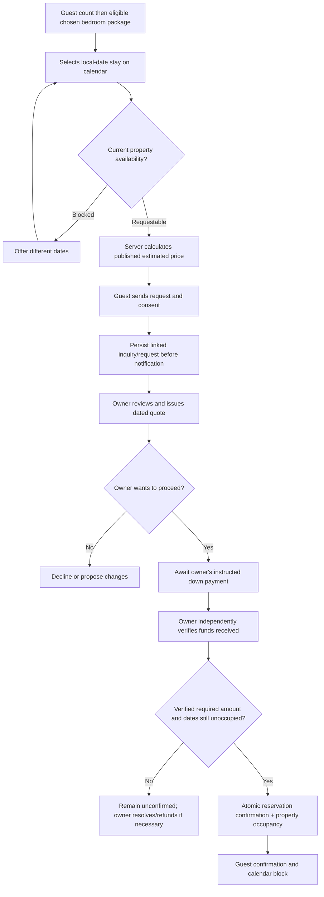

# TEN29 Holiday Homes — Master Product Brief

**Document status:** Existing implementation brief reconciled on **2026-10-13** with the direct unit-owner decisions supplied in this session. Those decisions supersede conflicting assumptions below; unrelated factual claims, unresolved commercial policies and production launch still require actual-owner authorization. Routine valid rates published by the authorized OWNER require no additional developer approval. This document is not evidence of deployment or completion of future capabilities.

**Working product name:** TEN29 Owner-Managed Booking & Content System (Option 1.5)

**Repository:** https://github.com/jusbreakindacycle/ten29-holiday-homes

**Current demonstrated URLs reported by Project Steward:** https://ten29holidayhomes.tiiny.site/ and https://ten29holidayhomes.tiiny.site/owner-preview . Their live behavior has not been independently verified here; repository's protected owner-preview route is `/admin/owner-preview`, not necessarily the public demo `/owner-preview`.

**Prepared:** October 11, 2026 (Philippine time). **Original baseline:** branch `main`, commit `c1fa8360fa5ea4cc6fd9a18c15566cf87b562200` as inspected; always re-check HEAD before implementation.

---

## 1. Executive product decision

Add a **calendar-based request-to-book experience, package-specific owner-controlled prices, iPhone/Android photo and video gallery uploads, and a mobile-friendly owner dashboard** to the existing Option 1 website. **Do not replace the codebase.** Support manually entered bookings from every channel. A stay can become `CONFIRMED` **only after the authorized owner/staff independently verifies receipt of the required down payment under the actual owner's approved deposit policy** and the database atomically establishes that the property-wide stay interval has no conflict.

TEN29 is **one physical private house** offering three bedroom-access packages (1, 2 or 3 bedrooms). Regardless of package, a reservation occupies the **entire property for a single guest group**. No selling leftover bedrooms to another party.

### Product decisions

| ID | Decision | Result | Owner sign-off boundary |
|---|---|---|---|
| DEC-20261011-01 | Public calendar | Show requestable/unavailable dates and **approved** nightly estimated prices; final quote is owner-confirmed | No unapproved prices or live availability claims |
| DEC-20261011-02 | Packages | Guests choose **1, 2, or 3 bedrooms** while booking the entire private house | Bedroom allocation and capacities are owner-confirmed below; active package prices require OWNER publication |
| DEC-20261011-03 | Rate editor | Owner can edit standard/day-of-week rates and date-specific overrides; include holiday and promotion controls only when approved | Historical rate figures are not final owner-approved commercial rates |
| DEC-20261011-04 | Media | Choose and upload photos **and videos from phone gallery**, Android or iPhone; no device-specific limitation | Actual owner must authorize rights to each asset and any media-processing recurring cost |
| DEC-20261011-05 | Confirmation | Owner marks reservation confirmed **only after down payment received and independently verified**; owner may enter manual bookings from any channel | Deposit amount/percentage, payment methods, receipt verification authority and balance deadlines await owner's explicit approval |
| DEC-20261013-01 | Accommodation and capacity | One entire private house for one guest group for every package; 1BR max 2, 2BR max 4, 3BR max 6; overall max 8 with up to 2 additional folding foams in the 3BR package | Owner-confirmed accommodation facts; foam charges, child-counting and daytime visitor rules remain unapproved |

**Approval boundary:** Project Steward decisions guide product design but do not override owner-confirmed property facts or the code-enforced public-claim approval system. DEC-20261013-01 is directly owner-confirmed accommodation policy. Current rates become public through authorized OWNER draft/review/publication, without developer reapproval; foam fees, payment rules and other unapproved commercial terms remain unpublished until the actual owner approves them.

## 2. Business context and verified property facts

- Name: TEN29 Holiday Homes. Geographic identity: Biclatan, General Trias, Cavite. Not a Tagaytay property. Phrase travel access toward Amadeo/Tagaytay carefully, without guarantee.
- The unit owner directly confirmed on October 13, 2026 that TEN29 is always rented as **one entire private house for one guest group**, regardless of bedroom package. The package controls which bedrooms are opened; all non-included bedrooms remain locked. Guests retain private use of approved common areas and amenities for every package. TEN29 is not shared accommodation and never sells separate rooms to unrelated groups.
- Owner-confirmed overnight capacities are: `WHOLE_HOME_1BR` up to 2 guests, `WHOLE_HOME_2BR` up to 4, and `WHOLE_HOME_3BR` up to 6. Maximum property occupancy is 8, accommodated by up to two additional folding foams within the 3-bedroom package. For 7–8 overnight guests, recommend the 3-bedroom package with the folding-foam option. The foams are not a separate room, package, or property inventory.
- These owner-confirmed capacities supersede earlier prototype or unresolved-capacity assumptions (including the former proposed base-6/max-8 wording). Do not infer child-counting rules, daytime-visitor allowances or foam charges. No extra-guest or folding-foam fee is approved or assumed.
- Owner-confirmed bedrooms: Room 1 has a queen-size bed; Room 2 has twin-size bedding (exact bed count remains ambiguous); Room 3 has a single-size double-deck bed. 1BR opens Room 1 and locks Rooms 2-3; 2BR opens Rooms 1-2 and locks Room 3; 3BR opens all three. Preserve historical claim evidence and publication gates.
- Two bathrooms and hot/cold shower availability are owner-confirmed. Historical approved copy identifies one hot/cold shower; do not claim BOTH bathrooms have hot/cold showers without specific owner confirmation.
- Owner-confirmed operating hours: check-in **from 3:00 PM onwards**, check-out **before 12:00 PM**, timezone **Asia/Manila**. These clock times are separate from nightly `[check_in, check_out)` date calculations. No free early arrival, late checkout, grace period, fee, minimum stay or automatic same-day eligibility is inferred.
- Owner-approved facts include AC areas, Wi-Fi existence, specified kitchen equipment, entertainment, private lanai, gated parking existence (not number of vehicles), some safety equipment and CCTV presence only. **Never infer pool availability, safe guest occupancy, vehicle capacity, emergency capabilities or permit/HOA authority.**
- Current public content is subject to the code-enforced claim gate in `src/content/claims.ts`. Guest capacities above are owner-confirmed accommodation facts; public commercial terms and any additional-foam fees still require their own approval.
- Historical development contract amounts are omitted from this public specification. New scope, third-party recurring costs and developer fees require a separate private commercial agreement; prior amounts do not define this upgrade quote.

## 3. Inspected repository baseline and implementation status

### Inspected implementation

Reconciliation baseline: branch `feature/slice-2-reservation-domain`, HEAD `27eb7978fd648652f70288f473b23a8b6095caf1`; local `main` remains `c1fa8360fa5ea4cc6fd9a18c15566cf87b562200`. `AGENTS.md` is locally modified; `PRODUCT.md` and root `SKILL.md` are untracked. Preserve them; do not change branches or stage unrelated files. The existing root skill was moved intact to `.agents/skills/ten29-engineering/SKILL.md` for discovery during reconciliation closure; no duplicate skill is maintained. `CLAUDE.md` remains the existing compatibility pointer.

- Next.js 16.2.12 App Router, React 19.2.4, TypeScript strict, Tailwind 4, Supabase Auth/Postgres SSR, Resend, Zod; Vitest + Playwright.
- Public site routes including `/`, `/property`, `/gallery`, `/rates`, `/availability`, `/book`, `/location`, `/faq`, `/contact`, `/privacy`, `/terms`, `/policies`.
- `/book` currently has separate native HTML check-in/check-out date inputs, a structured enquiry form, Zod/honeypot/timing checks, persist-first email notification, human-readable reference codes, and non-booking language.
- `/availability` explicitly says manual verification; there is no live calendar or automatic blocked-date checking.
- `/rates` and owner preview currently render code-controlled approval-gated claims, not an operational editable price database.
- `/gallery` and homepage use placeholder images. `GalleryCard` supports a `src` parameter but no owner upload, image content store or video management UI exists.
- Admin login, inquiry list/filter, notes/status, CSV export, read-only owner-preview and claim registry are preserved. Slice 2 adds booking request/quote/deposit services and tables, a future reservation scaffold, request audit history, OWNER-only quote issuance and immutable quote snapshots. Deposits can only be recorded unverified; no reservation confirmation operation, property occupancy exclusion, owner booking calendar or rate/media editor exists in this checkout.
- Legacy `inquiries` and `inquiry_audit_events` remain separate from booking request states. Migrations `0003` through `0005` add membership authorization, reservation-domain foundations and owner-confirmed capacity enforcement. Migration `0005_owner_confirmed_guest_capacity.sql` already supports larger eligible package selections; preserve it unchanged.
- **Historical security gap addressed in Slice 1:** `getAdminUser()` now checks `is_ten29_admin`; booking services and database policies enforce TEN29 membership. OWNER quote issuance is separately checked server-side and in SQL. No claim is made here about hosted migration state or provider-backed behavior.
- Host/deployment gap: demo on Tiiny Host is not evidence the dynamic Next.js/Supabase backend is running. Verify actual domain, environment and hosting separately. Existing full-stack hosting recommendation is Vercel with owner-held credentials, subject to budget and commercial terms.
- Historical July test results remain historical evidence. Current reconciliation validation is recorded below when actually executed; provider-backed live functionality is not verified.

### Preserve

All existing enquiry records, legacy URLs, published factual statements, public-claim approval gates, SEO, admin session concept, source tracking/UTM fields, email provider interface, server-side validation, tests and build-without-production-secrets capability where feasible.

### Avoid

A rewrite, a mobile app, a generic PMS, automatic payment gateway, Meta API, Airbnb/Agoda channel synchronization, dynamic AI pricing, automated guest reviews, auto-confirmations, in-browser collection of debit/credit-card data, premature analytics suite, or dozens of new Markdown planning files.

## 4. Scope hierarchy

### MUST (Option 1.5 MVP)

1. Accessible mobile-friendly date-range calendar with coarse confirmed/unavailable statuses, request submission, selected package, approved price estimate and conspicuous non-confirmation notice.
2. Three bedroom-access packages, all mutually exclusive at the **property** level. Owner can draft/publish package descriptions and prices when authorized.
3. Owner intake and management of website requests and manual requests from Messenger, call/text, walk-in and other sources.
4. Manual quote and down-payment verification fields; explicit, server-enforced booking state transition; database-enforced non-overlap across packages, confirmed bookings, owner blocks and any active temporary holds.
5. Owner availability calendar with manual unavailable dates and optional explicit temporary payment holds; requests and confirmed reservations use different visual statuses.
6. Editable package base/weeknight/weekend pricing plus manual date overrides, owner-declared holiday rate categories, audit history and draft/publish separation. Do not invent an automated PH holiday feed.
7. Owner-friendly gallery uploads from Android/iPhone photo libraries **for both photos and videos** with upload progress, safe processing/validation, reorder, cover image, captions/alt, draft/publish and deletion workflow.
8. Explicit TEN29 admin membership/roles with server action + route handler authorization and scoped RLS; secure storage permissions.
9. Guest and owner notifications with persistent record even if email delivery fails. Clear failure/retry and no fake confirmation.
10. Requirements-linked tests, launch checks, accessible UI, practical owner handover.

### SHOULD (after stable core / if affordable)

- Unconfirmed quote expiry with owner approval, configurable temporary holds and automated expiry cleanup.
- Formal proof-of-payment upload into PRIVATE storage for owner review (a screenshot alone is never automatically validated).
- Exportable owner booking calendar/CSV, reminders, basic arrival/departure list, media compression/transcoding background queue, small owner reports.
- Additional editor accounts after role/approval policy established.

### EXCLUDED from this upgrade unless later authorized

Instant booking, payment gateway and webhook auto-verification, OTA sync, AI Messenger assistant, multi-property support, public reviews, automated discounts/promotions beyond owner configured rules, mobile apps, full financial accounting/guest deposit ledger, and third-party PMS integrations.

## 5. Personas and roles

- **Guest (anonymous):** view published facts, public availability and approved estimated prices, choose a package and dates, submit request, receive non-confirmation acknowledgment. Never access other guest records.
- **Owner:** sole ultimate publisher/approver (or delegates by explicit role). Manages packages, rates, bookings, blocks, deposits, media and settings through mobile-first admin.
- **Authorized booking manager (optional initially):** can view assigned booking details and handle requests/deposit verification only if owner explicitly grants; publish pricing/media only if separately authorized.
- **Developer:** can deploy/maintain code but not authorize public business claims, verify personal account transfers, hold customer funds or launch without owner approval.

**Role matrix (minimum):** Guest = read public only and submit rate-limited request. Owner = all operational actions and publishing. Booking-manager = access to booking operations only if owner opted into role. Developer = no permanent access to live guest/financial data without owner delegation. Authenticated Supabase users outside TEN29 membership = no access.

## 6. Guest-facing information architecture and UI/UX

### Public routes (reuse existing)

- `/`: image/video hero from approved media, concise value proposition, three package-selection cards, starting-from published prices (if approved), availability CTA, factual property highlights, source links.
- `/property`: approved property description, private whole-house model, bedroom access inclusions with no implied separate occupancy, galleries and house features.
- `/gallery`: owner-published photos and videos with device-optimized responsive delivery; alt/captions and safe video controls.
- `/rates`: package comparisons, published rate types and charges, estimate vs final quote, policy disclosures.
- `/availability`: **public interactive calendar**, unobtrusive legend, package selector, stay date range, price preview, call to request.
- `/book`: form prefilled with selected dates and package, contact and group details; server rechecks dates/amount and displays unambiguous 'request received, not reserved' success.
- `/contact`, `/location`, `/faq`, policies/privacy/terms: preserve and only update approved content.
- Existing URLs remain stable; use routing changes only when required and provide redirects where necessary.

### Design system and accessibility

Preserve restrained TEN29 brand appearance already in repository (forest/ivory/gold/sand), clear hierarchy, generously sized mobile tap targets, legible system fallbacks, keyboard-accessible calendar dates and aria-live alerts; WCAG 2.2 AA target for core workflows. Mobile-first breakpoints ~360px, 390px, 768px, desktop. Prefer small responsive tables or cards over horizontal scrolling of bookings. Language may remain existing English; no forced Taglish UI without owner choice. Include loading/empty/error/success/skeleton/retry states, slow/mobile network progress and no dark-pattern urgency.

**Future guest-calendar contract (deferred UI slice):**

"One private house. Choose how many bedrooms you'd like opened."

Guest count -> eligible bedroom package -> calendar dates -> current nightly prices -> estimated total -> Request to Book.

Initial selection: **1 overnight guest**, `WHOLE_HOME_1BR`, Room 1 opened with a queen-size bed, whole property private and exclusive. This is a changeable selection, never a reservation.

When guest count changes, recalculate the smallest eligible recommendation separately from validation. Preserve the selected larger package whenever eligible. If it becomes ineligible, select the smallest eligible package and clearly announce the change; never automatically downgrade a valid larger package. Update bedroom access, occupancy/foam information and applicable published estimates. Use the chosen package for prices, even for a smaller guest group.

Show property-wide availability and published nightly prices for the selected package; support ranges across months/years and adjacent stays. Summarize guest count, package, opened bedrooms, nights, nightly breakdown and estimated total. Show only approved applicable charges. Missing prices show "Request a quote." No minimum-stay or turnover restrictions are invented.

Before accepting a request, the server revalidates eligibility, availability and current published prices. If prices changed while selecting dates, recalculate and disclose the refreshed estimate before acceptance. Persist a request with clear non-confirmation language, never an automatically confirmed reservation. Final confirmation requires an eligible request, applicable owner-issued quote, independently verified required down payment, authorized confirmation and successful atomic database conflict checks.

**Important:** Public availability MUST NOT expose guest identity, payment status, reason for owner blocks, or private booking details. Checkout day is available as the next guest's check-in day unless an explicit turnover/block rule forbids it.

### Owner dashboard IA

- `/admin`: overview (pending requests, awaiting deposit, confirmed arrivals, upload failures), recent activity, failed notifications.
- `/admin/calendar`: month/week/day availability, sitewide blocks, pending requests, provisional holds, confirmed stays, manual date blocks; tap days to manage.
- `/admin/requests`: website and owner-entered source-tagged request records; quote/requote, decline and contact history.
- `/admin/reservations`: confirmed reservations, reschedule/cancel (with policy check), deposit verification ledger and history.
- `/admin/rates` (future pricing slice): mobile-friendly visual calendar editor per package; default nightly rate, optional weekday/weekend rules, individual-date overrides, bulk date-range and month changes; save/edit/preview drafts, publish and revise published rates, view effective dates and prior versions. Prefer calendar bulk actions over a complicated spreadsheet. Only the authorized OWNER publishes routine rates, without additional developer approval; unrelated factual-claim gates remain separate.
- `/admin/media`: mobile library upload for photos/videos, media progress and processing status, categories, cover/ordering, alt descriptions, publish/unpublish.
- `/admin/settings`: owner-authorized policy/content revisions and users (only when membership system complete).
- `/admin/owner-preview`: preserve claim gate review, but not pretend this read-only route is the operational dashboard.

**Owner rate UI example:**

```
Package: [1 bedroom v]   Publication: [Draft]
Sun–Thu nightly [PHP ___]   Fri [PHP ___]  Sat [PHP ___]
Declared holiday [PHP ___]  Peak override [PHP ___]
[Add special dates] [Preview price] [Save draft] [Publish]*
*Only an authorized publisher may publish approved values.
```

**Owner media UI example:**

```
[+ Add from Photos / Gallery]  Photo | Video
[Thumbnail] Uploaded · processing · failed · published
[Title / accessible description] [Category] [Cover] [Move] [Remove]
[Preview changes] [Publish approved]
```

## 7. Reservation domain and workflow

### Exact states

- **Request**: `NEW` → `REVIEWING` → `QUOTED` → `AWAITING_DEPOSIT` → after payment verification, `CONFIRMED` (through creation/link of reservation); or `DECLINED`, `WITHDRAWN`, `EXPIRED`.
- **Deposit record**: `RECORDED_UNVERIFIED` → `VERIFIED` / `REJECTED`, with verified amount, method, external masked reference, timestamp, verifier ID and audit; recorded date alone does not prove receipt.
- **Reservation**: `CONFIRMED` → `COMPLETED` or `CANCELLED` (reschedule requires conflict checks and audit). A reservation only exists as confirmed after owner verifies the required down payment and availability transaction succeeds.
- **Dates**: `REQUESTABLE`, `UNAVAILABLE_CONFIRMED`, `UNAVAILABLE_OWNER_BLOCK`, `PROVISIONAL_HOLD` (if feature enabled; never label a hold a confirmed reservation). Requests can overlap each other without lying about reservation status.

Do not simply reuse legacy `inquiries.status` as the confirmed reservation state; retain legacy meaning for compatibility and create linked booking domain records with status transitions audited. Requests from all channels get source-specific metadata; never fabricate automatically synced external bookings.

### Full guest and owner flow



### Booking conflicts and deposit risk

A fresh request can land while another inquiry is pending. **Never publicly imply its stay is held.** When the owner offers payment instructions, the owner should have an **optional, visible, expiring provisional hold** on the full property, created with the same database conflict protection as confirmed occupancy. This is strongly recommended to avoid collecting deposits from two parties for the same dates. Hold duration and expiry policy remain actual-owner decisions; do not invent 24h/48h deadlines. The expiry must release reliably with scheduled cleanup plus a server-side transaction-time expiry check. If overlapping payment claims nevertheless occur, never silently accept both: block the second confirmation, flag an owner resolution/refund task and contact the guest manually.

On down-payment verification: enforce `verified_amount >= required_deposit_for_accepted_quote`, and quote validity/current owner-approved policy before atomic confirmation. The payment-channel source of truth is the bank/e-wallet or cash ledger verified by the owner; a screenshot is evidence to examine, **not payment verification**. Do not automatically verify via OCR or SMS. No public confirmation email until database confirmation successfully commits. Idempotency keys stop retry duplicates.

Manual entry: owner selects source (`MESSENGER`, `PHONE`, `WALK_IN`, `EXTERNAL_PLATFORM`, `OTHER`), chooses package/dates, records guest with consent and source, calculates/verifies quote, verifies required deposit, then runs the **same** confirm transaction. External already-confirmed bookings that occurred before TEN29's system launch require a supervised reconciliation/import workflow with factual owner verification before marking dates occupied; never auto-mark fake deposit proof.

## 8. Pricing and packages

### Packages

- `WHOLE_HOME_1BR`: entire private house for one group; Room 1 opened (queen-size bed), Rooms 2-3 locked; maximum 2 overnight guests.
- `WHOLE_HOME_2BR`: entire private house for one group; Rooms 1-2 opened (queen-size bed and twin-size bedding), Room 3 locked; maximum 4 overnight guests.
- `WHOLE_HOME_3BR`: entire private house for one group; Rooms 1-3 opened (queen-size bed, twin-size bedding, single-size double-deck bed); standard maximum 6 overnight guests. Up to 2 additional folding foams may be requested within this package for 7–8 guests, subject to the maximum property occupancy of 8.

Every package retains private use of approved common areas and amenities, and all three packages occupy the same whole property for the full stay. Included bedrooms are opened; other bedrooms remain locked. The folding-foam option is not separate inventory. Bedroom allocation is confirmed above. Child-counting, daytime visitor rules and any foam fee remain unresolved. Do not infer those rules from the confirmed total overnight guest count.

The booking request must carry an explicit total overnight guest count, validated against the selected package on the server and in PostgreSQL: up to 2 for 1BR, up to 4 for 2BR, and up to 8 for 3BR only when the folding-foam option is selected for guests above 6. Reject counts above 8. Recommendation: 1BR for 1–2 guests, 2BR for 3–4, and 3BR for 5–8; for 7–8, explicitly recommend the folding-foam option. This is a package recommendation only, not an availability, price, or booking confirmation.

Recommendation is the minimum package, not the only permissible purchase:

| Overnight guests | Smallest recommendation | Eligible selections |
|---|---|---|
| 1-2 | 1BR | 1BR, 2BR, 3BR |
| 3-4 | 2BR | 2BR, 3BR |
| 5-6 | 3BR | 3BR |
| 7-8 | 3BR with folding foams | 3BR with additional bedding |
| Above 8 | None | Reject |

A two-guest group may buy 3BR to open every bedroom and pays the selected 3BR whole-house rate. `recommendBookingPackage` does not rewrite request selections; Zod, service validation and migration `0005` already enforce the eligible upper limits. The existing boolean foam option must be selected for 7-8 guests; future UI must disclose adequate additional bedding, up to two foams. Do not invent a fourth package or fee.

### Owner-configurable rates

- Approved package base/default nightly rate; weekday rules as needed; Friday, Saturday and Sunday tiers are configurable (no unapproved hard-coded definitions).
- Special date override (single night or range) per package; owner-declared public/peak holiday dates. Do not assume national holiday calendar always applies to property charges.
- Promo code/manual owner-approved discount rules and extra-guest fees **only after verified approval**. Do not auto-combine multiple discounts without a published stacking rule.
- Fees: refundable security deposit is NOT nightly accommodation revenue; payment/down-payment and security deposit are separate concepts. Cleaning/extra person/day visitors/early/late fees only when owner approves them.
- Quotes show selected package, inclusive night-by-night itemization, approved fees/discounts, accommodation subtotal, estimated total, deposit needed if approved, balance and currency. Quote `valid_until` is a separate owner-defined policy. Preserve immutable quote snapshots on every re-quote, with rate version/hash, approval provenance and timestamp.

**Deterministic default precedence proposal, pending business approval for stacking:** explicit selected-date override > explicitly owner-tagged peak/holiday rule > configured weekday rule > package base rate. Resolve ambiguity (overlapping override precedence) by validation and visible owner warning before publishing. Dates use Philippines calendar days, check-in inclusive/check-out exclusive. Freeze past quote and require re-quote acceptance for a change.

### Promotional reference confidentiality and dynamic publication

The owner-supplied promotional matrix is confidential structure/reference material, not active rates. Do not publish its image, reproduce the complete original/promo table as a permanent public page, commit confidential reference material, log it in CI or expose it through downloadable assets. Do not hardcode reference figures into components, migrations, seeds or this specification as production prices. Earlier ambiguous confidentiality wording is superseded: **current individual nightly booking prices SHOULD be visible through the interactive calendar once OWNER-published**.

Historical price/payment proposals remain evidence in existing July documents (including `docs/21_DECISION_LOG.md`); their numeric repetition is removed from this maintained brief. Do not delete evidence, promote historical figures to live rates, or infer a deposit percentage or additional fee.

The authorized TEN29 OWNER account is the commercial source of truth. Valid routine rate publication follows save -> preview/review -> publish, with server and database OWNER authorization, rate validation, private draft state, versioning/effective dates and audit events. No developer reapproval is needed. This does not bypass unrelated property-claim approvals.

Public calendar reads retrieve applicable published prices dynamically by selected package and date. Support day/date-range/month/package variation; refresh subsequent views after publication through deliberate cache invalidation/versioning. Draft rates must never leak through public APIs, metadata, caches or search results. The server calculates each night in the Manila `[check_in, check_out)` span with integer minor units or exact NUMERIC and returns an itemized PHP total; the package rate is whole-house accommodation, not per person. Never invent charges. If any necessary rate is missing, show "Request a quote" rather than fabricate a complete estimate. Rate edits preserve previously issued quote snapshots and revisions unchanged.

These are acceptance contracts for the later pricing/calendar slices, not an implemented editor or public pricing endpoint. No active prices are supplied by this reconciliation.

## 9. Media upload and publication

**Owner requirement is local phone gallery upload on both Android and Apple iPhone**, including photos **and videos**. File selection must work through each platform's native photo picker/browser file input; no reliance on public URLs or a desktop computer.

### Workflow

1. Authorized owner taps `Add photos/videos`, selects local assets on Android or iOS, sees preview and permitted file types/size, gets progress/error/retry.
2. Client obtains scoped authenticated upload grant; uploads directly to private staging or authenticated storage using safe unique object paths. Do not send service-role key to client.
3. Server validates file signature, MIME/container/codec, size/duration/pixel bounds, safety requirements and storage quotas; remove GPS/EXIF/location where feasible, generate safe image variants/poster thumbnails and transcode incompatible output to web-friendly format using an actually configured pipeline.
4. Media is `UPLOADED` → `PROCESSING` → `READY_FOR_REVIEW` or `FAILED`; nothing is public until approved/published. iPhone HEIC/HEIF photos and MOV/HEVC videos need explicit support/testing (including Live Photos selection behavior). If conversion is unavailable, show a clear unsupported-content failure; never display success for an unplayable uploaded video.
5. Owner edits category, caption, alt text, visibility, featured-cover flag and sort order; previews and publishes only owned/authorized assets. Deleting/unpublishing must remove public access promptly, while retention/audit rules still apply.
6. Public site serves safe transformed image URLs with `srcset`/responsive `next/image` configuration or equivalent; video has controls, poster, lazy load, captions when available and muted auto-play only where accessibility/user choice permits.

**Costs/architecture:** Supabase Storage may hold private uploads and public approved renditions; standard uploads are recommended only for small files, and resumable TUS uploads for larger videos and unstable mobile networks. Video MOV/HEVC transcoding requires an actual media-processing service or verified processing worker with explicit budget. Choose managed streaming vs storage+worker after testing and calculating monthly uploads, storage, egress, encoding fees. Upload quotas must be configurable rather than assumed to be free/unlimited. Define device acceptance fixtures and iOS Safari permissions behavior before claiming launch readiness.

## 10. Data architecture (conceptual; implement through numbered migrations)

Maintain existing `inquiries` and `inquiry_audit_events`. Add tables/typed entities only as justified:

| Entity | Purpose / critical fields |
|---|---|
| `properties` | One TEN29 property ID; timezone `Asia/Manila` |
| `property_packages` | 1BR/2BR/3BR, whole-property mode, owner-confirmed maximum overnight guests (2/4/6), description, verified inclusions, publish status |
| `rates` / `rate_rules` | package ID, local-date applicability, day type, PHP amount, revision, draft/published/owner approval |
| `rate_overrides` | package/date or date span, amount, validated precedence, provenance |
| `booking_requests` | linked nullable `inquiry_id`, source, package, dates, total overnight guests, 3BR folding-foam option, request status, traceability |
| `quote_versions` | immutable server-produced itemized price/deposit/policy snapshot; revision, owner confirmation |
| `manual_payment_records` | request/reservation, amount, method, masked reference, status, owner verified timestamp/user; private evidence reference if approved |
| `reservations` | one confirmed whole-property stay, linked request/quote, dates, package, immutable confirmation details, status history |
| `property_occupancies` | unified per-property date occupancy for confirmed reservations, owner blocks and active provisional holds |
| `media_assets` | original private storage key, safe rendition key, type/codec, dimensions/duration, category, processing/publish state, order, alt/caption, rights assertion |
| `admin_memberships` | TEN29 organization, auth user ID, role, active/revoked, grants |
| `audit_events` | entity, actor, event, safe before/after, occurred at, request ID without financial secrets/guest PII spill |
| `notification_outbox` | durable email events, dedup/idempotency key, send attempt/status/error, retry |

### Property-wide database exclusion invariant

Implement a schema-level constraint that rejects overlapping **active** occupancy for the single property, regardless of package. PostgreSQL design direction, to adapt/validate against the deployed PostgreSQL version:

```sql
CREATE EXTENSION IF NOT EXISTS btree_gist;
-- On property_occupancies (after defining property_id, check_in_date,
-- check_out_date, active, and constraints; illustrative snippet):
ALTER TABLE public.property_occupancies
  ADD CONSTRAINT no_overlapping_active_property_stays
  EXCLUDE USING gist (
    property_id WITH =,
    daterange(check_in_date, check_out_date, '[)') WITH &&
  ) WHERE (active = true);
```

Dates must satisfy checkout > checkin. Confirm deposit + create `reservations` + insert occupancy + audit in **one atomic database transaction** (for example, a security-hardened PostgreSQL function with explicit authorization and fixed `search_path` plus tests). If exclusion fails, do not mark reservation/payment as confirmed. Ensure owners cannot bypass the constraint by editing separate packages. Holds must expire by deliberate active-state update, not by pretending a time-dependent partial index can use `NOW()`. The owner must be able to resolve stuck holds visibly.

### Database roles and permissions

- `anon`: read only approved public facts, coarse availability, sanitized published rates and media, via safe server read endpoints; submit bounded enquiry through validated server entry point (no direct table read).
- TEN29 owner membership: server+RLS-authorized management permissions.
- Optional staff role: least privilege for booking workflow, no rate/media publish unless explicitly delegated.
- Authenticated non-member: **nothing** private. Public link IDs must not enable guest PII enumeration.
- Private buckets: deposits/payment evidence/original media, not public. Approved public renditions can be public only through intentional publication.

Migrations are forward-only, transactional where supported, backed up, staged and tested. Confirm that migrations have been applied in live project before modifying it. Do not blanket-allow the entire `authenticated` role.

## 11. Functional acceptance criteria with traceability

| ID | Requirement | Observable acceptance |
|---|---|---|
| TEN-CAL-01 | Calendar picker | Select multi-day check-in/check-out on mobile/keyboard; correct PHP local-date rollover; dates in past rejected |
| TEN-CAL-02 | Public privacy | Only aggregate requestable/blocked state returned; no owner/guest identities or private reasons |
| TEN-CAL-03 | Package exclusivity | Every confirmed 1/2/3BR booking blocks every package for same property interval |
| TEN-CAL-04 | Manual blocks | Owner may block/unblock dates; guests cannot submit unavailable dates as if available |
| TEN-REQ-01 | Submit request | Persist valid request/selected package/dates/source; show reference and **not confirmed** notice; email failure doesn't erase it |
| TEN-REQ-02 | Manual channels | Owner enters Messenger/phone/walk-in/external request with source; same validations and calendar |
| TEN-REQ-03 | Status flow | Unauthorized actor or invalid transition rejected; all changes logged |
| TEN-BOOK-01 | Deposit gate | No confirm without owner-verified required amount and an accepted quote; screenshot alone insufficient |
| TEN-BOOK-02 | Atomic confirmation | Concurrent overlapping confirmations: exactly one success; loser shown conflict, no false email |
| TEN-BOOK-03 | Deposit failure | Insufficient/unverified amount leaves request unconfirmed; no occupancy created |
| TEN-BOOK-04 | Active holds | Owner-only provisional hold clearly marked as not confirmed; cannot overlap active occupancy; expiry works |
| TEN-RATE-01 | Package pricing | Owner creates separately approved/published rates for 1/2/3BR; public never shows prototype-only prices |
| TEN-RATE-02 | Date overrides | Correct precedence, applicable date span and currency rounding; invalid collisions blocked |
| TEN-RATE-03 | Quotes | Server-calculated itemized estimate/quote with immutable version; old quote unaffected by later rate edit |
| TEN-RATE-04 | Draft/publish | Unauthorized publish denied; owner review and audit evident |
| TEN-MEDIA-01 | Android/iOS pick | Native Android and iPhone library selection for photos and videos with progress, error/retry |
| TEN-MEDIA-02 | Safe processing | Unsupported content rejected clearly; allowed iOS formats work or are converted with real tested service |
| TEN-MEDIA-03 | Publication | Reorder, categorize, cover, alt/caption, preview, publish/unpublish; draft not public |
| TEN-ADMIN-01 | Permissions | Authenticated nonmember receives 403/no private rows; owner role works through server and RLS |
| TEN-ADMIN-02 | Mobile | Owner can use dashboard, rates, date blocks, media and booking confirmation at 360px width |
| TEN-OPS-01 | Reliability | Outbox handles email retries; clear user feedback; backup, restore and deployment tests documented |
| TEN-OPS-02 | Privacy/accessibility | No guest PII leakage; keyboard and screen-reader journey; media stripped of unnecessary GPS metadata |

### Reconciliation acceptance traceability (2026-10-13)

| ID | Required evidence | Applicable slice / current evidence |
|---|---|---|
| TEN-PKG-01 | 1 guest recommends 1BR; all count boundaries; larger eligible choices retained | Existing unit recommendations/capacity tests plus upgrade regression matrix and service persistence test |
| TEN-PKG-02 | 3-4 reject 1BR, 5-6 require 3BR, 7-8 require foams, >8 reject | Existing Zod/service and pgTAP capacity cases; expanded eligibility matrix; SQL upgrade regression added |
| TEN-PKG-03 | Default 1 guest/1BR; access matches purchased package; eligible larger selection never downgraded | Future guest UI slice; schema/service preservation tested here; UI not implemented/tested |
| TEN-RATE-05 | Only OWNER publishes; drafts private in API/metadata/cache/search; published package/date values visible | Future pricing slice, integration and public-endpoint/E2E tests required |
| TEN-RATE-06 | Date-range/month revisions refresh views; differing nightly prices, exact totals; stale estimate disclosed before acceptance | Future pricing/calendar slices, calculation and cache/revalidation tests required |
| TEN-RATE-07 | Missing rates show "Request a quote"; static promotional matrix absent from public pages/assets | Future pricing/calendar and public-content regression tests required; no matrix or rates introduced here |
| TEN-RATE-08 | Source rate edits never mutate issued snapshots | Existing SQL quote immutability foundation; future rate-edit integration regression required |
| TEN-CAL-05 | Cross-package conflicts, blocks, adjacent/year-boundary spans, private availability, request never auto-confirmed | Slice 3 occupancy/atomic confirmation tests then guest calendar E2E; request state/forced-confirmation guards already tested |
| TEN-OPS-03 | From 3 PM / before noon, Asia/Manila; no inferred arrival/fee restrictions | Future public-copy/calendar UI checks; owner-confirmed specification here |
| TEN-MEDIA-04 | Actual owner assets, private upload staging, tested Android/iOS formats and publication | Future media slice; not implemented/tested in reconciliation |

## 12. Non-functional requirements

- **Security/privacy:** least-privilege RLS, rate limiting, CSRF/session checks, guest consent, no service-role secrets in browser, cryptographically unguessable object identifiers, safe logs, auditable owner actions and account revocation.
- **Correctness:** all financial calculations deterministic, amounts in integer centavos/NUMERIC; date spans use Asia/Manila local dates; DB concurrency protection, not only an availability read.
- **Performance:** responsive images and lazy video loading; fast initial mobile rendering; avoid loading video with the homepage unless requested. Exact latency/Web Vitals goals need measurement baseline.
- **Reliability:** persist-first enquiry, retryable idempotent email/outbox and media processing, safe backup/restore; no phantom confirmation on API timeouts.
- **Accessibility:** WCAG 2.2 AA target; keyboard date selection, visible focus, descriptive alt, contrast, validation announcements, captions for meaningful videos when supplied.
- **Portability:** avoid lock-in beyond deliberate Supabase/hosting choices; follow supported Next.js API, keep separate storage/media provider interfaces if processing services are external.
- **Cost control:** show estimated recurring charges for hosting, DB, image/video storage, transcoding, outbound bandwidth and email. No promise of unlimited free tiers.
- **Data lifecycle:** owner must approve retention windows for enquiries, payment proof, logs, original photos and videos before production.
- **Compatibility:** modern Android Chrome, iOS Safari, desktop Chrome/Edge/Firefox. Test real-device HEIC/HEVC/MOV handling and upload retries.

## 13. Security and privacy threat model / red team

**Assets:** booking occupancy truth, financial receipts and deposit verification, guest PII, owner credentials, media rights, public pricing trust.

**Attackers/failures:** anonymous bot, compromised TEN29 account, unrelated Supabase authenticated user, malicious uploader, concurrent owner admins, mistaken owner edits, stale browser data, failed email/storage service.

**Critical tests required before release:**

- Simultaneous overlapping 1BR and 3BR confirmations: one must fail atomically (TEN-CAL-03, TEN-BOOK-02).
- Unauthenticated and authenticated non-TEN29 users cannot view guest info, alter prices, upload/delete media or verify deposits (TEN-ADMIN-01).
- Forged `paid=true`, `status=CONFIRMED`, selected package cost or deposit amount in request body has zero authority (TEN-BOOK-01, TEN-RATE-03).
- Payment screenshot supplied but no bank/e-wallet verification never allows confirmation.
- Checkout date equal to next checkin permitted if no turnover block; adjacent stays and year boundary work.
- Rate updated between display and submit; show refreshed breakdown, preserve old quote, never silently charge new amount.
- MIME-spoofed photos/videos, SVG/HTML injection, huge uploads, unsafe object paths, GIF/polyglot payloads rejected or quarantined, with storage permissions enforced.
- iPhone video from Photos that uses unsupported codec cannot be published as playable content until transcoded successfully.
- CSV export sanitizes spreadsheet formulas and respects viewer's permissions.
- Payment received but occupied interval lost to earlier confirmation: block second reservation and flag owner resolution/refund; no false success.
- Deployment with misconfigured DB/email shows safe errors and health monitors rather than fabricated bookings.

### Reconciliation risk register

| Risk | Finding and mitigation | Remaining gate |
|---|---|---|
| Unapproved/stale pricing | No active rates/editor exist here. Confidential matrix is withheld; future OWNER publication, private drafts and cache invalidation specified | Pricing slice tests and actual OWNER publication |
| Booking conflict / false confirmation | Slice 2 rejects forced confirmed state and has no authenticated reservation writes; whole-property exclusion/atomic verification not yet implemented | Continue approved Slice 3; prove concurrency and owner blocks before enabling confirmation |
| Claim overstatement | Room 2 bed count and BOTH-bathroom shower wording unresolved; historical claim registry preserved | Specific owner confirmation and existing publication gates |
| Evidence vs execution | Service integration tests use a fake Supabase client; SQL assertions alone do not prove hosted behavior | Run disposable database tests; no hosted migration in this task |
| Local source loss | PRODUCT/SKILL are untracked and AGENTS modified; no branch switch, staging or instruction replacement | Review local diff before any separately authorized commit |

## 14. SDLC / staged roadmap

This is *incremental execution of the existing repo*, not a new project. Each phase closes a tested vertical slice and updates this document's status matrix only with evidence.

| Gate | Workstream | Exit evidence |
|---|---|---|
| M0 | Inspect live repo, provider accounts, runtime, owner approvals, baseline tests, rollback plan | Diff/risk inventory, verified credentials owner-controlled, no unapproved claims published |
| M1 | Security and data foundation: TEN29 memberships/RLS, new booking/rate/media schema and DB collision constraints | Nonmember RLS tests; concurrency test proving one active occupancy per property interval |
| M2 | Package selection + real public calendar + request creation | Mobile/keyboard E2E, cross-package availability correctness, non-confirmation language |
| M3 | Owner booking calendar, manual channel intake, quote and deposit verification + confirmation | Verified-deposit and blocked-date E2E, concurrency, audit, notification failures |
| M4 | Package-based rate editor, publish/override rules, snapshots | Calculation unit suite + owner-only publishing + old quote unchanged |
| M5 | Android/iOS photo/video uploads and publication | Real phone acceptance, MIME/codec validation, retry, media rights, public renditions |
| M6 | Integration hardening, UAT, privacy, monitoring, backup/restore, owner training, deployment | Owner sign-off; launch checklist and production smoke tests passed |

**Future work sequencing (not authorization to begin here):** Rate schema/engine can be developed after M1 while booking UIs progress; UI copies must still withhold unpublished prices. Media upload architecture may be prototyped early, but it is incomplete until genuine iPhone/Android photo+video tests and hosting-cost approval pass. Avoid phase labels as excuses for fake finished features.

### Definition of done (per feature)

- Requirement ID, approved design and explicit owner approval if relevant.
- Code, migration, type mapping, RLS/server authorization and rollback reviewed.
- Real responsive/accessible UI, empty/error/progress states, audit trail.
- Unit/integration/E2E and relevant red-team tests **actually run** and results recorded.
- No regression to existing inquiry system and no old production data lost.
- Provider/cost behavior understood, operations and backup covered.

## 15. Release/handover controls

Production accounts should be owned by TEN29/actual unit owner; developer receives least privilege. Developer must verify actual hosting platform supports full-stack Next.js/Supabase, rather than relying solely on Tiiny static demo behavior. Domain/SMTP/HTTPS/DB/Storage credentials are configured on the owner-controlled deployment, never in git. Production launch requires tested backups and recovery, migration success, safe roles/RLS, booking concurrency proof, deposit verification flow, owner-approved rate/public facts, mobile upload compatibility, legal/privacy materials, owner UAT and explicit sign-off.

Owner training should cover calendar blocks, manually importing outside bookings, price revisions, verifying money in real bank/e-wallet, handling conflicts and refunds, media publishing, reclaiming lost account access, and managing costs. Never auto-send real payment instructions before the approved account and payment policy are in place.

## 16. Open decisions and publication blockers (do not invent values)

These do **not** change the five decisions already answered; they are unresolved actual-owner policy facts that cannot be guessed:

1. Active nightly rates per package need authorized OWNER publication; no developer approval is needed for valid routine updates. Bedroom allocation, bed wording, capacities (2/4/6; overall 8 with 3BR foams) and operating hours are confirmed. Child-counting, daytime visitors, any additional-foam/extra-guest fee and exact Room 2 bed count remain unresolved. Confirm specifically before claiming BOTH bathrooms have hot/cold showers. Marketing copy alone does not approve every amenity or complimentary essential; preserve historical claim gates.
2. Verified down-payment policy: percentage vs fixed amount, source of payment truth, authorized verifier, how much paid is enough, minimum lead time, balance deadline and what happens if payment is late.
3. How/when an owner may place a provisional hold, for how long and expiry notification policy.
4. Date-specific rate stacking, holidays, refundable security deposit, promos, fees, discounts, cancellation/reschedule/refund policy; all subject to actual owner approval.
5. Original photo/video ownership permissions, upload/video storage/transcoding budget, retention and acceptable duration/size, privacy policy for media including visible people.
6. Confirm actual production domain/host, payment-contact instructions, operating authority/HOA/regulatory prerequisites, final contacts, email and consent/retention language.

**Safe default:** show draft previews to authenticated owner only, display "Request a quote" publicly when no approved price exists, and never open public payment/auto-confirmation gates without approved deposit and booking conditions. If no authorized pricing or package capacity is available, the guest can still submit a request with selected package and dates, but cannot be shown a fabricated quote or eligibility guarantee.

Package capacity is now owner-confirmed and must be enforced for booking requests. Missing approved prices or payment terms still block public estimates and payment/confirmation behavior. Do not treat the 7–8 guest folding-foam option as a separate room or invent a fee.

## 17. Decision register / status of this document

| ID | Decision and rationale | Current state |
|---|---|---|
| HIST-20260727-01 | Existing Option 1 booking enquiry site, not instant booking | Implemented baseline, preserve |
| HIST-20260728-01 | Owner-supplied physical accommodation facts are published subject to claim approval | Approved historical facts, preserve exact copy/gates |
| HIST-20260728-02 | Proposed rate and payment policy package documented, not owner-confirmed | Unverified for production; do not auto-seed as live |
| DEC-20261011-01 | Guest calendar with requestable/blocked state and approved estimates | Design-approved, NOT implemented |
| DEC-20261011-02 | Choose 1/2/3BR bedroom access, whole-home exclusivity | Package domain implemented in Slice 2; guest selection UI deferred |
| DEC-20261011-03 | Owner edits package rates plus special dates | Design-approved, NOT implemented |
| DEC-20261011-04 | Owner chooses and uploads photos and videos from Android or iPhone gallery | Design-approved, NOT implemented |
| DEC-20261011-05 | Only owner-verified down payment allows confirmed status; manual entries all channels | Manual request/quote/unverified deposit foundation exists; verified confirmation remains Slice 3 |
| DEC-20261013-01 | Entire private house for one group; package capacities 2/4/6; maximum 8 with up to two folding foams inside 3BR | Owner-confirmed; helper, Zod/service and migration 0005 implement capacity rules |
| DEC-20261013-02 | Minimum recommendation separate from eligibility; larger eligible purchases retained; initial 1 guest/1BR | Domain already permits upgrades; regression coverage added; UI selection behavior deferred |
| DEC-20261013-03 | Exact Room 1/2/3 allocation and bed wording; check-in from 3 PM, checkout before noon Manila time | Owner-confirmed specification; public copy remains subject to claim gates |
| DEC-20261013-04 | Confidential static promo matrix; dynamic OWNER-published nightly prices and mobile editor | Supersedes ambiguous confidentiality wording; no active figures supplied, pricing slice deferred |
| DEC-20261013-05 | Chosen-package nightly estimates, fresh server revalidation, immutable issued quotes | Pricing/calendar contract specified; quote immutability foundation exists in Slice 2 |
| ARCH-01 | Keep Next.js/Supabase and preserve source/history; three maintained instruction docs | Proposed architectural approach, not applied |
| ARCH-02 | Unified property occupancy database exclusion to prevent overlapping packages | Slice 3 required invariant, not implemented |
| SEC-01 | Replace broad authenticated access with explicit TEN29 admin membership + RLS | Implemented and verified in Slice 1 |
| OPS-01 | Move actual full-stack runtime to compatible host; Tiiny demo remains an optional showcase | Proposed, live deployment unverified |

**Executed reconciliation validation (2026-10-13):** `npm run lint` and `npm run typecheck` passed. Initial `npm run test` failed with worker-start timeouts (37 tests passed, seven worker errors); rerun `npm run test -- --maxWorkers=1 --pool=threads` passed **158 tests in 12 files**, including the package eligibility matrix and two-guest 3BR persistence/idempotency regression. `next build` within `npm run test:e2e` passed. Its initial E2E run passed six tests and failed two navigation tests (loading-state visibility timeout and navigation timeout); `npx playwright test --workers=1` then passed **all eight existing E2E tests**. The default parallel runs remain subject to worker/loading timeouts on this machine; no test configuration was changed. Deferred pricing/calendar/media behavior is not covered by these existing E2E tests. `git diff --check` passed. `supabase test db --local supabase/tests` could not connect to local PostgreSQL at port 54322, so the 43-assertion booking SQL suite (including the new larger-package regression) was **not executed**. No hosted database was contacted or migrated. Vitest service integration coverage uses a fake client and does not establish database/RLS/concurrency behavior.

**Reconciliation boundary:** This update changes this existing brief and focused regression tests only; application code, migrations, instruction files and public claims remain unchanged. On reconciliation closure, commits and feature-branch pushes plus isolated CI verification are explicitly authorized; hosted migrations, merge and deployment remain prohibited. Slice 3 can continue its already-approved occupancy/confirmation backend scope unchanged; no new feature slice begins here. Hosted database state, concurrency safety and production suitability are not verified by this update.

### Reconciliation closure and authorized Slice 3 (2026-10-13)

Reconciliation **VERIFIED** at `c3222a7213d0f7114eb52ca2a68d3d7255c64f98`: the isolated GitHub Actions run https://github.com/jusbreakindacycle/ten29-holiday-homes/actions/runs/38386807491 replayed migrations 0001-0005 and passed **55 pgTAP assertions**, including the new two-guest 3BR database regression (43 booking-domain + 12 authorization assertions). Relevant application checks are recorded above. Confidentiality audit omitted historical nightly/promo values and private development-contract amounts from this tracked brief; no promotional image, reference-price material, personal owner data or production secrets were added. Historical evidence files are preserved, without new exposure of their values.

The existing engineering skill is now maintained only at `.agents/skills/ten29-engineering/SKILL.md`; the existing `CLAUDE.md` pointer is unchanged. The owner-authorized execution branch is `feature/slice-3-atomic-confirmation`, based on verified Slice 2 `c3222a7`. Feature commits/pushes and disposable CI verification are authorized; merge, hosted database changes and deployment are not.

**Slice 3 contract:** migration 0006 adds whole-property `[check_in, check_out)` exclusion shared by reservations and owner-unavailable blocks, append-only OWNER payment verification/rejection events, and atomic OWNER confirmation against the request's latest applicable issued PHP quote and positive required verified deposit. The required deposit is supplied by the issued quote, never a seeded percentage. Existing payment records and issued quotes remain unchanged. Confirmation captures package/dates/occupancy/quote/verified total, creates occupancy and audits in one transaction; failures roll back all confirmation writes. Matching retries return the same record; mismatched replay keys cannot duplicate or alter history. Request-row locks serialize verification/confirmation; the exclusion constraint arbitrates competing requests and blocks. Public availability returns bounded, clipped unavailable date spans only, with no guest/payment/status/reason fields. Private implementations use fixed search paths outside the exposed schema; public RPC wrappers and services enforce OWNER authorization. Owner block release retains its audit/history; confirmed reservation cancellation is deferred rather than exposing an unaudited release path. No holds or invented duration rules are added.

Existing scaffold reservation rows must undergo supervised reconciliation before migration 0006 can run; it deliberately refuses to invent their payment/occupancy history. Legacy requests lacking a verified overnight count cannot confirm. No hosted database state is inspected or changed in this task.

**Evidence gates:** existing SQL/RLS tests plus focused atomic-confirmation pgTAP assertions; real separate PostgreSQL transactions for cross-package confirmation races, matching retry races and block/confirmation races, with observed database lock waits and rollback checks; application validation and existing enquiry E2E. Initial Slice 3 database CI at `9097ff2` passed **115 pgTAP assertions** and all three real concurrency scenarios with observed PostgreSQL lock waits, including rollback of the conflicting confirmation. CI lint/typecheck and **170 Vitest tests** also passed. The default Linux Turbopack build failed in the existing Google-font import map (not booking code); CI now uses the installed Next.js 16.2.12 supported `--webpack` production build and then the existing E2E suite, while local default-build validation is checked separately. Slice 3 status remains **PARTIALLY VERIFIED** until final application build/E2E checks finish. Initial run: https://github.com/jusbreakindacycle/ten29-holiday-homes/actions/runs/38388439783 . Pricing/calendar/media slices and production approvals remain deferred; stop after Slice 3.

## 18. Sources within existing repository

- `README.md`, `CHANGELOG.md`, `package.json`, `AGENTS.md`, `CLAUDE.md`.
- `docs/00_PROJECT_CHARTER.md`, `docs/08_USER_FLOWS.md`, `docs/09_DATA_MODEL.md`, `docs/10_TECHNICAL_ARCHITECTURE.md`, `docs/11_FUNCTIONAL_REQUIREMENTS.md`, `docs/19_UPGRADE_ROADMAP.md`, `docs/21_DECISION_LOG.md`, `docs/26_PROJECT_STEWARD_DECISION_AND_OWNER_VERIFICATION.md`, `docs/27_TEN29_OWNER_FACTUAL_CONFIRMATION.md`.
- `src/content/claims.ts`, `src/app/(public)/availability/page.tsx`, `src/app/(public)/book`, `src/app/(public)/rates/page.tsx`, `src/app/(public)/gallery/page.tsx`, `src/lib/supabase/get-admin-user.ts`, `src/services/inquiry-service.ts`, `supabase/migrations/0001_init.sql`, `supabase/migrations/0002_rls.sql`.

## 19. Simple prompt contract (for your next coding-agent message)

Attach/reference only the three maintained instruction files and instruct the agent to **audit before implementing**. Provide an explicit task mode (AUDIT / DESIGN / BUILD / FIX / RED TEAM / RELEASE), scope IDs, and proof criteria. Keep product decisions here instead of inventing a new prompt format for every task. Do not let broad agent autonomy override money, security, guest data or production approval gates.
