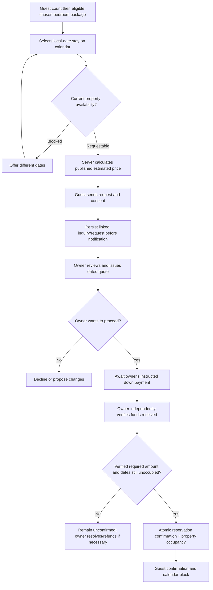

# TEN29 Holiday Homes — Master Product Brief

**Current policy authority — 2026-10-15:** The actual OWNER policies supplied for Slice 9 supersede earlier commercial/counting assumptions in this historical brief. The implementation version is `TEN29-20261015-v1`; this identifies the software transition, not a retrospective owner-approved effective date for old agreements. Production launch remains unauthorized.

| Decision | Current OWNER policy / implementation boundary |
|---|---|
| DEC-20261015-01: age-band counts | Included countable guests 2/4/6; maxima 3/5/8 for 1BR/2BR/3BR. Children aged 3 and below are exempt from these commercial limits and fees, but remain in actual overnight headcount. Adults and children older than 3 count. No dates of birth or child names. Larger eligible packages remain selectable. |
| DEC-20261015-02: approved extras | OWNER individually authorizes the requested arrangement; PHP 400 per extra chargeable guest per accommodation night includes foam, linen, towel, dental kit and slippers. No separate rental fee. One authoritative extra line; general adjustments cannot duplicate extra-guest/bedding charges. |
| DEC-20261015-03: payments | Bank transfer/GCash; standard 30% down and 70% balance due seven days before check-in. Short notice requires full payment. Final accommodation excluding refundable security is a proposed calculation basis, explicitly authorized per quote. Exactly seven days is reviewable through the final down amount (30% or full) and explicit OWNER boundary approval. No gateway, invented account instructions, auto-verification or late-payment cancellation. |
| DEC-20261015-04: security | Separate refundable obligations PHP 1,500/1,800/2,000; OWNER manages collection timing. Independent collection verification, inspection, deductions by reason code, authorized refund and actual settlement are distinct immutable events. Refund target 24–48 hours after checkout is a reminder. Security never increases accommodation revenue or satisfies confirmation. |
| DEC-20261015-05: cancellation/reschedule | Normal policy states 50% reservation-fee refund; same-day/no-show states full booking forfeiture. Separately paid balance disposition remains ambiguous: final verified-money allocation is OWNER controlled, with no automatic refund. One protected rescheduling request; actual date replacement stays blocked. Late 60-day credit/30% processing needs an explicit basis and start/end decision. |
| DEC-20261015-06: non-storage | Complete House Rules remain outside TEN29. No contents, copies, hashes, PDF, hosted link, attachment, conversation evidence, publication summary or automatic sending. OWNER records only delivery status on an actual paid confirmed stay. Acknowledgement requires genuine external evidence and prior delivery. Material conditions must be directly communicated before collecting money; no undisclosed-rules consent checkbox. |

The 32-person total input bound and review flag above eight actual occupants are software abuse/review controls, **not** owner-approved physical safety capacity. Commercial exemptions do not establish compliance with applicable legal or physical safety requirements. No physical limit is invented.

Slice 9 extends existing request, pricing, payment and confirmation transactions in forward-only `0011_owner_booking_policies.sql`. Old requests remain `LEGACY`, with absent age-band counts; existing quote snapshots, payments, reservations, occupancy exclusion and cancellation histories are not recalculated. New request counting is immutable. Versioned quote snapshots capture occupancy, approval reference, extra arithmetic, payment basis, required amounts, deadline and separately quoted security. Linked OWNER authorization events record final approval before issuance.

| Traceability | Implementation / proof target |
|---|---|
| Guest/package policy | Shared owner-policy/booking/guest-booking/pricing schemas; existing BookingJourney and manual owner intake; unit and provider-backed 1BR/2BR/3BR scenarios |
| Owner financial approvals | Existing quotation editor, pricing service, atomic confirmation and ongoing accommodation payment verification; PostgreSQL OWNER/manager denial, immutability and insufficient-payment assertions |
| Separate security and review | Existing request detail with OwnerPolicyOperations; one immutable OWNER-only policy-event table; exact verified receipt/refund allocation, once-only rescheduling and protected cancellation review |
| Non-storage and public restrictions | Public policies route uses direct-communication guidance only; prototype rule contents redacted from current source/historical documents (documents retained). Metadata-only RPC rejects additional content. Explicit document-reference text ingress and labelled-file guard; existing MIME/signature restrictions reject PDFs. |
| Availability and recovery | Existing database property-wide exclusion unchanged; old concurrency suites plus current-policy competing package/retry cases; migration replay, provider UI, media and isolated recovery in disposable CI. CI run 38624322425 passed on code commit `2252a259ce64ada42948e0195f97cca67d399114`. |

Risk register additions: physical-device/assistive-device UAT remains pending; arbitrary content in a renamed image or unlabelled text cannot be reliably identified by regex/type/signature validation. The current explicit-reference guard and OWNER guidance are not a semantic guarantee against an authorized operator deliberately copying confidential material. No OCR/AI classification, retention or external content service has been assumed or activated. Earlier source-control history may contain removed prototype rule copies; this slice does not rewrite Git history or alter external backups. No actual complete OWNER rules were supplied to or copied into this implementation. Owner must continue external delivery and avoid entering them in general notes or media. Existing development-only dependency advisories and all production release gates remain open.

**Slice 9 verification:** implementation and automated red-team checks are **VERIFIED in disposable CI** on code commit `2252a259ce64ada42948e0195f97cca67d399114` ([run 38624322425](https://github.com/jusbreakindacycle/ten29-holiday-homes/actions/runs/38624322425)). The run passed lint, typecheck, 248 unit tests across 23 files, Webpack production build, release verifier, 10 application Playwright tests, 34 provider-backed Playwright scenarios, database migration replay, all pgTAP/security assertions, concurrency checks, synthetic HEIC conversion/browser decode, Storage byte-for-byte recovery, and isolated PostgreSQL backup/restore with 32 table fingerprints and 36 restored pgTAP assertions (zero skipped). This verifies the implemented slice against disposable CI fixtures; physical Android/iOS and assistive-technology UAT remain pending. No hosted migrations, customer messages, staging, deployment or main merge were performed or authorized.

**Document status:** Existing implementation brief reconciled on **2026-10-13** with the direct unit-owner decisions supplied in this session. Those decisions supersede conflicting assumptions below; unrelated factual claims, unresolved commercial policies and production launch still require actual-owner authorization. Routine valid rates published by the authorized OWNER require no additional developer approval. This document is not evidence of deployment or completion of future capabilities.

**Working product name:** TEN29 Owner-Managed Booking & Content System (Option 1.5)

**Repository:** https://github.com/jusbreakindacycle/ten29-holiday-homes

**Current demonstrated URLs reported by Project Steward:** https://ten29holidayhomes.tiiny.site/ and https://ten29holidayhomes.tiiny.site/owner-preview . Their live behavior has not been independently verified here; repository's protected owner-preview route is `/admin/owner-preview`, not necessarily the public demo `/owner-preview`.

**Prepared:** October 11, 2026 (Philippine time). **Original baseline:** branch `main`, commit `c1fa8360fa5ea4cc6fd9a18c15566cf87b562200` as inspected; always re-check HEAD before implementation.

---

## 1. Executive product decision

Add a **calendar-based request-to-book experience, package-specific owner-controlled prices, iPhone/Android photo and video gallery uploads, and a mobile-friendly owner dashboard** to the existing Option 1 website. **Do not replace the codebase.** Support manually entered bookings from every channel. A stay can become `CONFIRMED` **only after the authorized owner/staff independently verifies receipt of the required down payment under the actual owner's approved deposit policy** and the database atomically establishes that the property-wide stay interval has no conflict.

TEN29 is **one physical private house** offering three bedroom-access packages (1, 2 or 3 bedrooms). Regardless of package, a reservation occupies the **entire property for a single guest group**. No selling leftover bedrooms to another party.

### Product decisions

| ID | Decision | Result | Owner sign-off boundary |
|---|---|---|---|
| DEC-20261011-01 | Public calendar | Show requestable/unavailable dates and **approved** nightly estimated prices; final quote is owner-confirmed | No unapproved prices or live availability claims |
| DEC-20261011-02 | Packages | Guests choose **1, 2, or 3 bedrooms** while booking the entire private house | Bedroom allocation and capacities are owner-confirmed below; active package prices require OWNER publication |
| DEC-20261011-03 | Rate editor | Owner can edit standard/day-of-week rates and date-specific overrides; include holiday and promotion controls only when approved | Historical rate figures are not final owner-approved commercial rates |
| DEC-20261011-04 | Media | Choose and upload photos **and videos from phone gallery**, Android or iPhone; no device-specific limitation | Actual owner must authorize rights to each asset and any media-processing recurring cost |
| DEC-20261011-05 | Confirmation | Owner marks reservation confirmed **only after down payment received and independently verified**; owner may enter manual bookings from any channel | Deposit amount/percentage, payment methods, receipt verification authority and balance deadlines await owner's explicit approval |
| DEC-20261013-01 | Accommodation and capacity | One entire private house for one guest group for every package; 1BR max 2, 2BR max 4, 3BR max 6; overall max 8 with up to 2 additional folding foams in the 3BR package | Owner-confirmed accommodation facts; foam charges, child-counting and daytime visitor rules remain unapproved |

**Approval boundary:** Project Steward decisions guide product design but do not override owner-confirmed property facts or the code-enforced public-claim approval system. DEC-20261013-01 is directly owner-confirmed accommodation policy. Current rates become public through authorized OWNER draft/review/publication, without developer reapproval; foam fees, payment rules and other unapproved commercial terms remain unpublished until the actual owner approves them.

## 2. Business context and verified property facts

- Name: TEN29 Holiday Homes. Geographic identity: Biclatan, General Trias, Cavite. Not a Tagaytay property. Phrase travel access toward Amadeo/Tagaytay carefully, without guarantee.
- The unit owner directly confirmed on October 13, 2026 that TEN29 is always rented as **one entire private house for one guest group**, regardless of bedroom package. The package controls which bedrooms are opened; all non-included bedrooms remain locked. Guests retain private use of approved common areas and amenities for every package. TEN29 is not shared accommodation and never sells separate rooms to unrelated groups.
- Owner-confirmed overnight capacities are: `WHOLE_HOME_1BR` up to 2 guests, `WHOLE_HOME_2BR` up to 4, and `WHOLE_HOME_3BR` up to 6. Maximum property occupancy is 8, accommodated by up to two additional folding foams within the 3-bedroom package. For 7–8 overnight guests, recommend the 3-bedroom package with the folding-foam option. The foams are not a separate room, package, or property inventory.
- These owner-confirmed capacities supersede earlier prototype or unresolved-capacity assumptions (including the former proposed base-6/max-8 wording). Do not infer child-counting rules, daytime-visitor allowances or foam charges. No extra-guest or folding-foam fee is approved or assumed.
- Owner-confirmed bedrooms: Room 1 has a queen-size bed; Room 2 has twin-size bedding (exact bed count remains ambiguous); Room 3 has a single-size double-deck bed. 1BR opens Room 1 and locks Rooms 2-3; 2BR opens Rooms 1-2 and locks Room 3; 3BR opens all three. Preserve historical claim evidence and publication gates.
- Two bathrooms and hot/cold shower availability are owner-confirmed. Historical approved copy identifies one hot/cold shower; do not claim BOTH bathrooms have hot/cold showers without specific owner confirmation.
- Owner-confirmed operating hours: check-in **from 3:00 PM onwards**, check-out **before 12:00 PM**, timezone **Asia/Manila**. These clock times are separate from nightly `[check_in, check_out)` date calculations. No free early arrival, late checkout, grace period, fee, minimum stay or automatic same-day eligibility is inferred.
- Owner-approved facts include AC areas, Wi-Fi existence, specified kitchen equipment, entertainment, private lanai, gated parking existence (not number of vehicles), some safety equipment and CCTV presence only. **Never infer pool availability, safe guest occupancy, vehicle capacity, emergency capabilities or permit/HOA authority.**
- Current public content is subject to the code-enforced claim gate in `src/content/claims.ts`. Guest capacities above are owner-confirmed accommodation facts; public commercial terms and any additional-foam fees still require their own approval.
- Historical development contract amounts are omitted from this public specification. New scope, third-party recurring costs and developer fees require a separate private commercial agreement; prior amounts do not define this upgrade quote.

## 3. Inspected repository baseline and implementation status

### Inspected implementation

Historical reconciliation baseline: branch `feature/slice-2-reservation-domain`, HEAD `27eb7978fd648652f70288f473b23a8b6095caf1`; local `main` remains `c1fa8360fa5ea4cc6fd9a18c15566cf87b562200`. At that inspection, `AGENTS.md` was locally modified and `PRODUCT.md` and root `SKILL.md` were untracked. Reconciliation closure subsequently tracked the reviewed instruction setup; preserve it and never stage unrelated files. The existing root skill was moved intact to `.agents/skills/ten29-engineering/SKILL.md` for discovery during reconciliation closure; no duplicate skill is maintained. `CLAUDE.md` remains the existing compatibility pointer.

- Next.js 16.2.12 App Router, React 19.2.4, TypeScript strict, Tailwind 4, Supabase Auth/Postgres SSR, Resend, Zod; Vitest + Playwright.
- Public site routes including `/`, `/property`, `/gallery`, `/rates`, `/availability`, `/book`, `/location`, `/faq`, `/contact`, `/privacy`, `/terms`, `/policies`.
- `/book` currently has separate native HTML check-in/check-out date inputs, a structured enquiry form, Zod/honeypot/timing checks, persist-first email notification, human-readable reference codes, and non-booking language.
- `/availability` explicitly says manual verification; there is no live calendar or automatic blocked-date checking.
- `/rates` and owner preview currently render code-controlled approval-gated claims, not an operational editable price database.
- `/gallery` and homepage use placeholder images. `GalleryCard` supports a `src` parameter but no owner upload, image content store or video management UI exists.
- Admin login, inquiry list/filter, notes/status, CSV export, read-only owner-preview and claim registry are preserved. Slice 2 adds booking request/quote/deposit services and tables, a future reservation scaffold, request audit history, OWNER-only quote issuance and immutable quote snapshots. Deposits can only be recorded unverified; no reservation confirmation operation, property occupancy exclusion, owner booking calendar or rate/media editor existed at that Slice 2 baseline. Slice 3 backend status below supersedes the confirmation/occupancy gaps. Slice 4 supersedes the rate-editor gap; the remaining booking/media UIs are deferred.
- Legacy `inquiries` and `inquiry_audit_events` remain separate from booking request states. Migrations `0003` through `0005` add membership authorization, reservation-domain foundations and owner-confirmed capacity enforcement. Migration `0005_owner_confirmed_guest_capacity.sql` already supports larger eligible package selections; preserve it unchanged.
- **Historical security gap addressed in Slice 1:** `getAdminUser()` now checks `is_ten29_admin`; booking services and database policies enforce TEN29 membership. OWNER quote issuance is separately checked server-side and in SQL. No claim is made here about hosted migration state or provider-backed behavior.
- Host/deployment gap: demo on Tiiny Host is not evidence the dynamic Next.js/Supabase backend is running. Verify actual domain, environment and hosting separately. Existing full-stack hosting recommendation is Vercel with owner-held credentials, subject to budget and commercial terms.
- Historical July test results remain historical evidence. Current reconciliation validation is recorded below when actually executed; provider-backed live functionality is not verified.

### Preserve

All existing enquiry records, legacy URLs, published factual statements, public-claim approval gates, SEO, admin session concept, source tracking/UTM fields, email provider interface, server-side validation, tests and build-without-production-secrets capability where feasible.

### Avoid

A rewrite, a mobile app, a generic PMS, automatic payment gateway, Meta API, Airbnb/Agoda channel synchronization, dynamic AI pricing, automated guest reviews, auto-confirmations, in-browser collection of debit/credit-card data, premature analytics suite, or dozens of new Markdown planning files.

## 4. Scope hierarchy

### MUST (Option 1.5 MVP)

1. Accessible mobile-friendly date-range calendar with coarse confirmed/unavailable statuses, request submission, selected package, approved price estimate and conspicuous non-confirmation notice.
2. Three bedroom-access packages, all mutually exclusive at the **property** level. Owner can draft/publish package descriptions and prices when authorized.
3. Owner intake and management of website requests and manual requests from Messenger, call/text, walk-in and other sources.
4. Manual quote and down-payment verification fields; explicit, server-enforced booking state transition; database-enforced non-overlap across packages, confirmed bookings, owner blocks and any active temporary holds.
5. Owner availability calendar with manual unavailable dates and optional explicit temporary payment holds; requests and confirmed reservations use different visual statuses.
6. Editable package base/weeknight/weekend pricing plus manual date overrides, owner-declared holiday rate categories, audit history and draft/publish separation. Do not invent an automated PH holiday feed.
7. Owner-friendly gallery uploads from Android/iPhone photo libraries **for both photos and videos** with upload progress, safe processing/validation, reorder, cover image, captions/alt, draft/publish and deletion workflow.
8. Explicit TEN29 admin membership/roles with server action + route handler authorization and scoped RLS; secure storage permissions.
9. Guest and owner notifications with persistent record even if email delivery fails. Clear failure/retry and no fake confirmation.
10. Requirements-linked tests, launch checks, accessible UI, practical owner handover.

### SHOULD (after stable core / if affordable)

- Unconfirmed quote expiry with owner approval, configurable temporary holds and automated expiry cleanup.
- Formal proof-of-payment upload into PRIVATE storage for owner review (a screenshot alone is never automatically validated).
- Exportable owner booking calendar/CSV, reminders, basic arrival/departure list, media compression/transcoding background queue, small owner reports.
- Additional editor accounts after role/approval policy established.

### EXCLUDED from this upgrade unless later authorized

Instant booking, payment gateway and webhook auto-verification, OTA sync, AI Messenger assistant, multi-property support, public reviews, automated discounts/promotions beyond owner configured rules, mobile apps, full financial accounting/guest deposit ledger, and third-party PMS integrations.

## 5. Personas and roles

- **Guest (anonymous):** view published facts, public availability and approved estimated prices, choose a package and dates, submit request, receive non-confirmation acknowledgment. Never access other guest records.
- **Owner:** sole ultimate publisher/approver (or delegates by explicit role). Manages packages, rates, bookings, blocks, deposits, media and settings through mobile-first admin.
- **Authorized booking manager (optional initially):** can view assigned booking details and handle requests/deposit verification only if owner explicitly grants; publish pricing/media only if separately authorized.
- **Developer:** can deploy/maintain code but not authorize public business claims, verify personal account transfers, hold customer funds or launch without owner approval.

**Role matrix (minimum):** Guest = read public only and submit rate-limited request. Owner = all operational actions and publishing. Booking-manager = access to booking operations only if owner opted into role. Developer = no permanent access to live guest/financial data without owner delegation. Authenticated Supabase users outside TEN29 membership = no access.

## 6. Guest-facing information architecture and UI/UX

### Public routes (reuse existing)

- `/`: image/video hero from approved media, concise value proposition, three package-selection cards, starting-from published prices (if approved), availability CTA, factual property highlights, source links.
- `/property`: approved property description, private whole-house model, bedroom access inclusions with no implied separate occupancy, galleries and house features.
- `/gallery`: owner-published photos and videos with device-optimized responsive delivery; alt/captions and safe video controls.
- `/rates`: package comparisons, published rate types and charges, estimate vs final quote, policy disclosures.
- `/availability`: **public interactive calendar**, unobtrusive legend, package selector, stay date range, price preview, call to request.
- `/book`: form prefilled with selected dates and package, contact and group details; server rechecks dates/amount and displays unambiguous 'request received, not reserved' success.
- `/contact`, `/location`, `/faq`, policies/privacy/terms: preserve and only update approved content.
- Existing URLs remain stable; use routing changes only when required and provide redirects where necessary.

### Design system and accessibility

Preserve restrained TEN29 brand appearance already in repository (forest/ivory/gold/sand), clear hierarchy, generously sized mobile tap targets, legible system fallbacks, keyboard-accessible calendar dates and aria-live alerts; WCAG 2.2 AA target for core workflows. Mobile-first breakpoints ~360px, 390px, 768px, desktop. Prefer small responsive tables or cards over horizontal scrolling of bookings. Language may remain existing English; no forced Taglish UI without owner choice. Include loading/empty/error/success/skeleton/retry states, slow/mobile network progress and no dark-pattern urgency.

**Future guest-calendar contract (deferred UI slice):**

"One private house. Choose how many bedrooms you'd like opened."

Guest count -> eligible bedroom package -> calendar dates -> current nightly prices -> estimated total -> Request to Book.

Initial selection: **1 overnight guest**, `WHOLE_HOME_1BR`, Room 1 opened with a queen-size bed, whole property private and exclusive. This is a changeable selection, never a reservation.

When guest count changes, recalculate the smallest eligible recommendation separately from validation. Preserve the selected larger package whenever eligible. If it becomes ineligible, select the smallest eligible package and clearly announce the change; never automatically downgrade a valid larger package. Update bedroom access, occupancy/foam information and applicable published estimates. Use the chosen package for prices, even for a smaller guest group.

Show property-wide availability and published nightly prices for the selected package; support ranges across months/years and adjacent stays. Summarize guest count, package, opened bedrooms, nights, nightly breakdown and estimated total. Show only approved applicable charges. Missing prices show "Request a quote." No minimum-stay or turnover restrictions are invented.

Before accepting a request, the server revalidates eligibility, availability and current published prices. If prices changed while selecting dates, recalculate and disclose the refreshed estimate before acceptance. Persist a request with clear non-confirmation language, never an automatically confirmed reservation. Final confirmation requires an eligible request, applicable owner-issued quote, independently verified required down payment, authorized confirmation and successful atomic database conflict checks.

**Important:** Public availability MUST NOT expose guest identity, payment status, reason for owner blocks, or private booking details. Checkout day is available as the next guest's check-in day unless an explicit turnover/block rule forbids it.

### Owner dashboard IA

- `/admin`: overview (pending requests, awaiting deposit, confirmed arrivals, upload failures), recent activity, failed notifications.
- `/admin/calendar`: month/week/day availability, sitewide blocks, pending requests, provisional holds, confirmed stays, manual date blocks; tap days to manage.
- `/admin/requests`: website and owner-entered source-tagged request records; quote/requote, decline and contact history.
- `/admin/reservations`: confirmed reservations, reschedule/cancel (with policy check), deposit verification ledger and history.
- `/admin/rates` (implemented and verified in Slice 4): mobile-friendly visual calendar editor per package; default nightly rate, optional weekday/weekend rules, individual-date overrides, bulk date-range and month changes; save/edit/preview drafts, publish and revise published rates, view effective dates and prior versions. Prefer calendar bulk actions over a complicated spreadsheet. Only the authorized OWNER publishes routine rates, without additional developer approval; unrelated factual-claim gates remain separate.
- `/admin/media`: mobile library upload for photos/videos, media progress and processing status, categories, cover/ordering, alt descriptions, publish/unpublish.
- `/admin/settings`: owner-authorized policy/content revisions and users (only when membership system complete).
- `/admin/owner-preview`: preserve claim gate review, but not pretend this read-only route is the operational dashboard.

**Owner rate UI example:**

```
Package: [1 bedroom v]   Publication: [Draft]
Sun–Thu nightly [PHP ___]   Fri [PHP ___]  Sat [PHP ___]
Declared holiday [PHP ___]  Peak override [PHP ___]
[Add special dates] [Preview price] [Save draft] [Publish]*
*Only an authorized publisher may publish approved values.
```

**Owner media UI example:**

```
[+ Add from Photos / Gallery]  Photo | Video
[Thumbnail] Uploaded · processing · failed · published
[Title / accessible description] [Category] [Cover] [Move] [Remove]
[Preview changes] [Publish approved]
```

## 7. Reservation domain and workflow

### Exact states

- **Request**: `NEW` → `REVIEWING` → `QUOTED` → `AWAITING_DEPOSIT` → after payment verification, `CONFIRMED` (through creation/link of reservation); or `DECLINED`, `WITHDRAWN`, `EXPIRED`.
- **Deposit record**: `RECORDED_UNVERIFIED` → `VERIFIED` / `REJECTED`, with verified amount, method, external masked reference, timestamp, verifier ID and audit; recorded date alone does not prove receipt.
- **Reservation**: `CONFIRMED` → `COMPLETED` or `CANCELLED` (reschedule requires conflict checks and audit). A reservation only exists as confirmed after owner verifies the required down payment and availability transaction succeeds.
- **Dates**: `REQUESTABLE`, `UNAVAILABLE_CONFIRMED`, `UNAVAILABLE_OWNER_BLOCK`, `PROVISIONAL_HOLD` (if feature enabled; never label a hold a confirmed reservation). Requests can overlap each other without lying about reservation status.

Do not simply reuse legacy `inquiries.status` as the confirmed reservation state; retain legacy meaning for compatibility and create linked booking domain records with status transitions audited. Requests from all channels get source-specific metadata; never fabricate automatically synced external bookings.

### Full guest and owner flow



### Booking conflicts and deposit risk

A fresh request can land while another inquiry is pending. **Never publicly imply its stay is held.** When the owner offers payment instructions, the owner should have an **optional, visible, expiring provisional hold** on the full property, created with the same database conflict protection as confirmed occupancy. This is strongly recommended to avoid collecting deposits from two parties for the same dates. Hold duration and expiry policy remain actual-owner decisions; do not invent 24h/48h deadlines. The expiry must release reliably with scheduled cleanup plus a server-side transaction-time expiry check. If overlapping payment claims nevertheless occur, never silently accept both: block the second confirmation, flag an owner resolution/refund task and contact the guest manually.

On down-payment verification: enforce `verified_amount >= required_deposit_for_accepted_quote`, and quote validity/current owner-approved policy before atomic confirmation. The payment-channel source of truth is the bank/e-wallet or cash ledger verified by the owner; a screenshot is evidence to examine, **not payment verification**. Do not automatically verify via OCR or SMS. No public confirmation email until database confirmation successfully commits. Idempotency keys stop retry duplicates.

Manual entry: owner selects source (`MESSENGER`, `PHONE`, `WALK_IN`, `EXTERNAL_PLATFORM`, `OTHER`), chooses package/dates, records guest with consent and source, calculates/verifies quote, verifies required deposit, then runs the **same** confirm transaction. External already-confirmed bookings that occurred before TEN29's system launch require a supervised reconciliation/import workflow with factual owner verification before marking dates occupied; never auto-mark fake deposit proof.

## 8. Pricing and packages

### Packages

- `WHOLE_HOME_1BR`: entire private house for one group; Room 1 opened (queen-size bed), Rooms 2-3 locked; maximum 2 overnight guests.
- `WHOLE_HOME_2BR`: entire private house for one group; Rooms 1-2 opened (queen-size bed and twin-size bedding), Room 3 locked; maximum 4 overnight guests.
- `WHOLE_HOME_3BR`: entire private house for one group; Rooms 1-3 opened (queen-size bed, twin-size bedding, single-size double-deck bed); standard maximum 6 overnight guests. Up to 2 additional folding foams may be requested within this package for 7–8 guests, subject to the maximum property occupancy of 8.

Every package retains private use of approved common areas and amenities, and all three packages occupy the same whole property for the full stay. Included bedrooms are opened; other bedrooms remain locked. The folding-foam option is not separate inventory. Bedroom allocation is confirmed above. Child-counting, daytime visitor rules and any foam fee remain unresolved. Do not infer those rules from the confirmed total overnight guest count.

The booking request must carry an explicit total overnight guest count, validated against the selected package on the server and in PostgreSQL: up to 2 for 1BR, up to 4 for 2BR, and up to 8 for 3BR only when the folding-foam option is selected for guests above 6. Reject counts above 8. Recommendation: 1BR for 1–2 guests, 2BR for 3–4, and 3BR for 5–8; for 7–8, explicitly recommend the folding-foam option. This is a package recommendation only, not an availability, price, or booking confirmation.

Recommendation is the minimum package, not the only permissible purchase:

| Overnight guests | Smallest recommendation | Eligible selections |
|---|---|---|
| 1-2 | 1BR | 1BR, 2BR, 3BR |
| 3-4 | 2BR | 2BR, 3BR |
| 5-6 | 3BR | 3BR |
| 7-8 | 3BR with folding foams | 3BR with additional bedding |
| Above 8 | None | Reject |

A two-guest group may buy 3BR to open every bedroom and pays the selected 3BR whole-house rate. `recommendBookingPackage` does not rewrite request selections; Zod, service validation and migration `0005` already enforce the eligible upper limits. The existing boolean foam option must be selected for 7-8 guests; future UI must disclose adequate additional bedding, up to two foams. Do not invent a fourth package or fee.

### Owner-configurable rates

- Approved package base/default nightly rate; weekday rules as needed; Friday, Saturday and Sunday tiers are configurable (no unapproved hard-coded definitions).
- Special date override (single night or range) per package; owner-declared public/peak holiday dates. Do not assume national holiday calendar always applies to property charges.
- Promo code/manual owner-approved discount rules and extra-guest fees **only after verified approval**. Do not auto-combine multiple discounts without a published stacking rule.
- Fees: refundable security deposit is NOT nightly accommodation revenue; payment/down-payment and security deposit are separate concepts. Cleaning/extra person/day visitors/early/late fees only when owner approves them.
- Quotes show selected package, inclusive night-by-night itemization, approved fees/discounts, accommodation subtotal, estimated total, deposit needed if approved, balance and currency. Quote `valid_until` is a separate owner-defined policy. Preserve immutable quote snapshots on every re-quote, with rate version/hash, approval provenance and timestamp.

**Slice 4 deterministic precedence (supersedes earlier holiday/stacking proposal):** explicit single-date override > explicit date-range/month override > configured day-of-week rule > default package rate. Equal-priority duplicate defaults/weekdays/dates and overlapping ranges are rejected. A single date may deliberately override a range. Months are ordinary date ranges, not another stacking layer. No automatic holidays, discounts, taxes or extra-guest/foam fees are introduced. Dates use Asia/Manila calendar days and checkout-exclusive nightly spans.

### Promotional reference confidentiality and dynamic publication

The owner-supplied promotional matrix is confidential structure/reference material, not active rates. Do not publish its image, reproduce the complete original/promo table as a permanent public page, commit confidential reference material, log it in CI or expose it through downloadable assets. Do not hardcode reference figures into components, migrations, seeds or this specification as production prices. Earlier ambiguous confidentiality wording is superseded: **current individual nightly booking prices SHOULD be visible through the interactive calendar once OWNER-published**.

Historical price/payment proposals remain evidence in existing July documents (including `docs/21_DECISION_LOG.md`); their numeric repetition is removed from this maintained brief. Do not delete evidence, promote historical figures to live rates, or infer a deposit percentage or additional fee.

The authorized TEN29 OWNER account is the commercial source of truth. Valid routine rate publication follows save -> preview/review -> publish, with server and database OWNER authorization, rate validation, private draft state, versioning/effective dates and audit events. No developer reapproval is needed. This does not bypass unrelated property-claim approvals.

Public calendar reads retrieve applicable published prices dynamically by selected package and date. Support day/date-range/month/package variation; refresh subsequent views after publication through deliberate cache invalidation/versioning. Draft rates must never leak through public APIs, metadata, caches or search results. The server calculates each night in the Manila `[check_in, check_out)` span with integer minor units or exact NUMERIC and returns an itemized PHP total; the package rate is whole-house accommodation, not per person. Never invent charges. If any necessary rate is missing, show "Request a quote" rather than fabricate a complete estimate. Rate edits preserve previously issued quote snapshots and revisions unchanged.

These are acceptance contracts for the later pricing/calendar slices, not an implemented editor or public pricing endpoint. No active prices are supplied by this reconciliation.

## 9. Media upload and publication

**Owner requirement is local phone gallery upload on both Android and Apple iPhone**, including photos **and videos**. File selection must work through each platform's native photo picker/browser file input; no reliance on public URLs or a desktop computer.

### Workflow

1. Authorized owner taps `Add photos/videos`, selects local assets on Android or iOS, sees preview and permitted file types/size, gets progress/error/retry.
2. Client obtains scoped authenticated upload grant; uploads directly to private staging or authenticated storage using safe unique object paths. Do not send service-role key to client.
3. Server validates file signature, MIME/container/codec, size/duration/pixel bounds, safety requirements and storage quotas; remove GPS/EXIF/location where feasible, generate safe image variants/poster thumbnails and transcode incompatible output to web-friendly format using an actually configured pipeline.
4. Media is `UPLOADED` → `PROCESSING` → `READY_FOR_REVIEW` or `FAILED`; nothing is public until approved/published. iPhone HEIC/HEIF photos and MOV/HEVC videos need explicit support/testing (including Live Photos selection behavior). If conversion is unavailable, show a clear unsupported-content failure; never display success for an unplayable uploaded video.
5. Owner edits category, caption, alt text, visibility, featured-cover flag and sort order; previews and publishes only owned/authorized assets. Deleting/unpublishing must remove public access promptly, while retention/audit rules still apply.
6. Public site serves safe transformed image URLs with `srcset`/responsive `next/image` configuration or equivalent; video has controls, poster, lazy load, captions when available and muted auto-play only where accessibility/user choice permits.

**Costs/architecture:** Supabase Storage may hold private uploads and public approved renditions; standard uploads are recommended only for small files, and resumable TUS uploads for larger videos and unstable mobile networks. Video MOV/HEVC transcoding requires an actual media-processing service or verified processing worker with explicit budget. Choose managed streaming vs storage+worker after testing and calculating monthly uploads, storage, egress, encoding fees. Upload quotas must be configurable rather than assumed to be free/unlimited. Define device acceptance fixtures and iOS Safari permissions behavior before claiming launch readiness.

## 10. Data architecture (conceptual; implement through numbered migrations)

Maintain existing `inquiries` and `inquiry_audit_events`. Add tables/typed entities only as justified:

| Entity | Purpose / critical fields |
|---|---|
| `properties` | One TEN29 property ID; timezone `Asia/Manila` |
| `property_packages` | 1BR/2BR/3BR, whole-property mode, owner-confirmed maximum overnight guests (2/4/6), description, verified inclusions, publish status |
| `rates` / `rate_rules` | package ID, local-date applicability, day type, PHP amount, revision, draft/published/owner approval |
| `rate_overrides` | package/date or date span, amount, validated precedence, provenance |
| `booking_requests` | linked nullable `inquiry_id`, source, package, dates, total overnight guests, 3BR folding-foam option, request status, traceability |
| `quote_versions` | immutable server-produced itemized price/deposit/policy snapshot; revision, owner confirmation |
| `manual_payment_records` | request/reservation, amount, method, masked reference, status, owner verified timestamp/user; private evidence reference if approved |
| `reservations` | one confirmed whole-property stay, linked request/quote, dates, package, immutable confirmation details, status history |
| `property_occupancies` | unified per-property date occupancy for confirmed reservations, owner blocks and active provisional holds |
| `media_assets` | original private storage key, safe rendition key, type/codec, dimensions/duration, category, processing/publish state, order, alt/caption, rights assertion |
| `admin_memberships` | TEN29 organization, auth user ID, role, active/revoked, grants |
| `audit_events` | entity, actor, event, safe before/after, occurred at, request ID without financial secrets/guest PII spill |
| `notification_outbox` | durable email events, dedup/idempotency key, send attempt/status/error, retry |

### Property-wide database exclusion invariant

Implement a schema-level constraint that rejects overlapping **active** occupancy for the single property, regardless of package. PostgreSQL design direction, to adapt/validate against the deployed PostgreSQL version:

```sql
CREATE EXTENSION IF NOT EXISTS btree_gist;
-- On property_occupancies (after defining property_id, check_in_date,
-- check_out_date, active, and constraints; illustrative snippet):
ALTER TABLE public.property_occupancies
  ADD CONSTRAINT no_overlapping_active_property_stays
  EXCLUDE USING gist (
    property_id WITH =,
    daterange(check_in_date, check_out_date, '[)') WITH &&
  ) WHERE (active = true);
```

Dates must satisfy checkout > checkin. Confirm deposit + create `reservations` + insert occupancy + audit in **one atomic database transaction** (for example, a security-hardened PostgreSQL function with explicit authorization and fixed `search_path` plus tests). If exclusion fails, do not mark reservation/payment as confirmed. Ensure owners cannot bypass the constraint by editing separate packages. Holds must expire by deliberate active-state update, not by pretending a time-dependent partial index can use `NOW()`. The owner must be able to resolve stuck holds visibly.

### Database roles and permissions

- `anon`: read only approved public facts, coarse availability, sanitized published rates and media, via safe server read endpoints; submit bounded enquiry through validated server entry point (no direct table read).
- TEN29 owner membership: server+RLS-authorized management permissions.
- Optional staff role: least privilege for booking workflow, no rate/media publish unless explicitly delegated.
- Authenticated non-member: **nothing** private. Public link IDs must not enable guest PII enumeration.
- Private buckets: deposits/payment evidence/original media, not public. Approved public renditions can be public only through intentional publication.

Migrations are forward-only, transactional where supported, backed up, staged and tested. Confirm that migrations have been applied in live project before modifying it. Do not blanket-allow the entire `authenticated` role.

## 11. Functional acceptance criteria with traceability

| ID | Requirement | Observable acceptance |
|---|---|---|
| TEN-CAL-01 | Calendar picker | Select multi-day check-in/check-out on mobile/keyboard; correct PHP local-date rollover; dates in past rejected |
| TEN-CAL-02 | Public privacy | Only aggregate requestable/blocked state returned; no owner/guest identities or private reasons |
| TEN-CAL-03 | Package exclusivity | Every confirmed 1/2/3BR booking blocks every package for same property interval |
| TEN-CAL-04 | Manual blocks | Owner may block/unblock dates; guests cannot submit unavailable dates as if available |
| TEN-REQ-01 | Submit request | Persist valid request/selected package/dates/source; show reference and **not confirmed** notice; email failure doesn't erase it |
| TEN-REQ-02 | Manual channels | Owner enters Messenger/phone/walk-in/external request with source; same validations and calendar |
| TEN-REQ-03 | Status flow | Unauthorized actor or invalid transition rejected; all changes logged |
| TEN-BOOK-01 | Deposit gate | No confirm without owner-verified required amount and an accepted quote; screenshot alone insufficient |
| TEN-BOOK-02 | Atomic confirmation | Concurrent overlapping confirmations: exactly one success; loser shown conflict, no false email |
| TEN-BOOK-03 | Deposit failure | Insufficient/unverified amount leaves request unconfirmed; no occupancy created |
| TEN-BOOK-04 | Active holds | Owner-only provisional hold clearly marked as not confirmed; cannot overlap active occupancy; expiry works |
| TEN-RATE-01 | Package pricing | Owner creates separately approved/published rates for 1/2/3BR; public never shows prototype-only prices |
| TEN-RATE-02 | Date overrides | Correct precedence, applicable date span and currency rounding; invalid collisions blocked |
| TEN-RATE-03 | Quotes | Server-calculated itemized estimate/quote with immutable version; old quote unaffected by later rate edit |
| TEN-RATE-04 | Draft/publish | Unauthorized publish denied; owner review and audit evident |
| TEN-MEDIA-01 | Android/iOS pick | Native Android and iPhone library selection for photos and videos with progress, error/retry |
| TEN-MEDIA-02 | Safe processing | Unsupported content rejected clearly; allowed iOS formats work or are converted with real tested service |
| TEN-MEDIA-03 | Publication | Reorder, categorize, cover, alt/caption, preview, publish/unpublish; draft not public |
| TEN-ADMIN-01 | Permissions | Authenticated nonmember receives 403/no private rows; owner role works through server and RLS |
| TEN-ADMIN-02 | Mobile | Owner can use dashboard, rates, date blocks, media and booking confirmation at 360px width |
| TEN-OPS-01 | Reliability | Outbox handles email retries; clear user feedback; backup, restore and deployment tests documented |
| TEN-OPS-02 | Privacy/accessibility | No guest PII leakage; keyboard and screen-reader journey; media stripped of unnecessary GPS metadata |

### Reconciliation acceptance traceability (2026-10-13)

| ID | Required evidence | Applicable slice / current evidence |
|---|---|---|
| TEN-PKG-01 | 1 guest recommends 1BR; all count boundaries; larger eligible choices retained | Existing unit recommendations/capacity tests plus upgrade regression matrix and service persistence test |
| TEN-PKG-02 | 3-4 reject 1BR, 5-6 require 3BR, 7-8 require foams, >8 reject | Existing Zod/service and pgTAP capacity cases; expanded eligibility matrix; SQL upgrade regression added |
| TEN-PKG-03 | Default 1 guest/1BR; access matches purchased package; eligible larger selection never downgraded | Slice 5 guest count/package UI and provider-backed larger-package/capacity regressions passed |
| TEN-RATE-05 | Only OWNER publishes; drafts private in API/metadata/cache/search; published package/date values visible | Slice 4 database authorization and provider-backed publication/API E2E passed; full guest UI deferred |
| TEN-RATE-06 | Date-range/month revisions refresh views; differing nightly prices, exact totals; stale estimate disclosed before acceptance | Slice 4 calculations/publication refresh and Slice 5 atomic submission/changed-price acknowledgement tests passed |
| TEN-RATE-07 | Missing rates show "Request a quote"; static promotional matrix absent from public pages/assets | Slice 4 and Slice 5 missing-rate API/database/UI request tests passed; no reference matrix or commercial rates seeded |
| TEN-RATE-08 | Source rate edits never mutate issued snapshots | Slice 4 actual PostgreSQL rate-edit/immutable snapshot regression and provider-backed quote preview passed |
| TEN-CAL-05 | Cross-package conflicts, blocks, adjacent/year-boundary spans, private availability, request never auto-confirmed | Slices 3-5 PostgreSQL/conflict tests and Slice 5 property-wide calendar, adjacent checkout and keyboard year-boundary E2E passed |
| TEN-OPS-03 | From 3 PM / before noon, Asia/Manila; no inferred arrival/fee restrictions | Slice 5 calendar shows owner-confirmed Manila operating hours; no inferred arrival fees/restrictions |
| TEN-MEDIA-04 | Actual owner assets, private upload staging, tested Android/iOS formats and publication | Future media slice; not implemented/tested in reconciliation |

### Supervised owner UAT acceptance sequence

Actual-owner UAT: **PENDING**. Run only with synthetic guest/payment records in an isolated environment and actual-owner-authorized media. Automated developer tests are not owner sign-off. Record identity/date/results in this acceptance section when actually executed.

1. Sign in with the authorized OWNER and review dashboard/navigation.
2. Publish a test-approved package rate, edit one date, and check the guest price; then restore test data.
3. Submit a synthetic guest request, recover a lost response and inspect the linked enquiry/request.
4. Create a Messenger manual request with a smaller group buying 3BR; review source and private contacts.
5. Prepare an itemized quote, explicitly approve a private charge/discount, preview and issue a revision; verify older snapshots remain unchanged.
6. Record a controlled synthetic payment as unverified; demonstrate denied confirmation, independently verify the fixture, then confirm and inspect all-package blocked dates.
7. Create/release an owner block, cancel with manual refund-review acknowledgement, and complete an eligible past synthetic stay; inspect immutable history.
8. Upload an owner-authorized photograph and supported video, preview, publish and unpublish; verify later public requests are denied.
9. Inspect notification pending/failure/acceptance status, recover a simulated expired worker and respect deduplication review limits.
10. Review Operations signals, retry a controlled processing failure/cleanup, and inspect the recovery rehearsal without exposing backup contents.
11. Verify manager denial, nonmember denial, account recovery contacts, session revocation and owner-held provider control.

Physical-device media cases: **NOT EXECUTED**, Slice 6 acceptance **PENDING**. On Android Chrome and iPhone Safari separately, select photos/videos from native gallery; check actual HEIC and MOV/HEVC, Live Photo selection behavior (no assumed motion support), Android MP4, upload interruption and retry, processing failure/retry, playback/poster/controls, publish/unpublish and mobile navigation. Record model/OS/browser, input codec, duration/size, visible progress/errors and publication checks. Chromium viewport tests do not satisfy this boundary. Screen-reader/assistive-device testing and formal contrast/a11y review remain pending; automated core labels/focus/layout are evidence only, not certification.

## 12. Non-functional requirements

- **Security/privacy:** least-privilege RLS, rate limiting, CSRF/session checks, guest consent, no service-role secrets in browser, cryptographically unguessable object identifiers, safe logs, auditable owner actions and account revocation.
- **Correctness:** all financial calculations deterministic, amounts in integer centavos/NUMERIC; date spans use Asia/Manila local dates; DB concurrency protection, not only an availability read.
- **Performance:** responsive images and lazy video loading; fast initial mobile rendering; avoid loading video with the homepage unless requested. Exact latency/Web Vitals goals need measurement baseline.
- **Reliability:** persist-first enquiry, retryable idempotent email/outbox and media processing, safe backup/restore; no phantom confirmation on API timeouts.
- **Accessibility:** WCAG 2.2 AA target; keyboard date selection, visible focus, descriptive alt, contrast, validation announcements, captions for meaningful videos when supplied.
- **Portability:** avoid lock-in beyond deliberate Supabase/hosting choices; follow supported Next.js API, keep separate storage/media provider interfaces if processing services are external.
- **Cost control:** show estimated recurring charges for hosting, DB, image/video storage, transcoding, outbound bandwidth and email. No promise of unlimited free tiers.
- **Data lifecycle:** owner must approve retention windows for enquiries, payment proof, logs, original photos and videos before production.
- **Compatibility:** modern Android Chrome, iOS Safari, desktop Chrome/Edge/Firefox. Test real-device HEIC/HEVC/MOV handling and upload retries.

## 13. Security and privacy threat model / red team

**Assets:** booking occupancy truth, financial receipts and deposit verification, guest PII, owner credentials, media rights, public pricing trust.

**Attackers/failures:** anonymous bot, compromised TEN29 account, unrelated Supabase authenticated user, malicious uploader, concurrent owner admins, mistaken owner edits, stale browser data, failed email/storage service.

**Critical tests required before release:**

- Simultaneous overlapping 1BR and 3BR confirmations: one must fail atomically (TEN-CAL-03, TEN-BOOK-02).
- Unauthenticated and authenticated non-TEN29 users cannot view guest info, alter prices, upload/delete media or verify deposits (TEN-ADMIN-01).
- Forged `paid=true`, `status=CONFIRMED`, selected package cost or deposit amount in request body has zero authority (TEN-BOOK-01, TEN-RATE-03).
- Payment screenshot supplied but no bank/e-wallet verification never allows confirmation.
- Checkout date equal to next checkin permitted if no turnover block; adjacent stays and year boundary work.
- Rate updated between display and submit; show refreshed breakdown, preserve old quote, never silently charge new amount.
- MIME-spoofed photos/videos, SVG/HTML injection, huge uploads, unsafe object paths, GIF/polyglot payloads rejected or quarantined, with storage permissions enforced.
- iPhone video from Photos that uses unsupported codec cannot be published as playable content until transcoded successfully.
- CSV export sanitizes spreadsheet formulas and respects viewer's permissions.
- Payment received but occupied interval lost to earlier confirmation: block second reservation and flag owner resolution/refund; no false success.
- Deployment with misconfigured DB/email shows safe errors and health monitors rather than fabricated bookings.

### Reconciliation risk register

| Risk | Finding and mitigation | Remaining gate |
|---|---|---|
| Unapproved/stale pricing | Slice 4 OWNER editor/publication, private drafts, version checks and no-store public reads verified; confidential matrix withheld | Actual commercial rates require OWNER publication; full guest request UI must acknowledge refreshed estimates |
| Booking conflict / false confirmation | Slice 3 adds owner-only atomic verification/confirmation with property-wide exclusion; direct writes denied; actual concurrency and rollback tests passed | Backend verified in disposable CI; owner workflow/UAT and approved payment policy still required before production |
| Claim overstatement | Room 2 bed count and BOTH-bathroom shower wording unresolved; historical claim registry preserved | Specific owner confirmation and existing publication gates |
| Evidence vs execution | Service integration tests use a fake client; disposable PostgreSQL and provider-backed UI tests supply separate real evidence | No hosted migrations or production suitability claimed; physical-device owner UAT remains |
| Local source loss | Historical untracked documents were audited and tracked at reconciliation closure; one discoverable skill and existing compatibility pointer preserved | Review focused diffs; never stage unrelated local work |

## 14. SDLC / staged roadmap

This is *incremental execution of the existing repo*, not a new project. Each phase closes a tested vertical slice and updates this document's status matrix only with evidence.

| Gate | Workstream | Exit evidence |
|---|---|---|
| M0 | Inspect live repo, provider accounts, runtime, owner approvals, baseline tests, rollback plan | Diff/risk inventory, verified credentials owner-controlled, no unapproved claims published |
| M1 | Security and data foundation: TEN29 memberships/RLS, new booking/rate/media schema and DB collision constraints | Nonmember RLS tests; concurrency test proving one active occupancy per property interval |
| M2 | Package selection + real public calendar + request creation | Mobile/keyboard E2E, cross-package availability correctness, non-confirmation language |
| M3 | Owner booking calendar, manual channel intake, quote and deposit verification + confirmation | Verified-deposit and blocked-date E2E, concurrency, audit, notification failures |
| M4 | Package-based rate editor, publish/override rules, snapshots | Calculation unit suite + owner-only publishing + old quote unchanged |
| M5 | Android/iOS photo/video uploads and publication | Real phone acceptance, MIME/codec validation, retry, media rights, public renditions |
| M6 | Integration hardening, UAT, privacy, monitoring, backup/restore, owner training, deployment | Owner sign-off; launch checklist and production smoke tests passed |

**Future work sequencing (not authorization to begin here):** Rate schema/engine can be developed after M1 while booking UIs progress; UI copies must still withhold unpublished prices. Media upload architecture may be prototyped early, but it is incomplete until genuine iPhone/Android photo+video tests and hosting-cost approval pass. Avoid phase labels as excuses for fake finished features.

### Definition of done (per feature)

- Requirement ID, approved design and explicit owner approval if relevant.
- Code, migration, type mapping, RLS/server authorization and rollback reviewed.
- Real responsive/accessible UI, empty/error/progress states, audit trail.
- Unit/integration/E2E and relevant red-team tests **actually run** and results recorded.
- No regression to existing inquiry system and no old production data lost.
- Provider/cost behavior understood, operations and backup covered.

## 15. Release/handover controls

Production accounts should be owned by TEN29/actual unit owner; developer receives least privilege. Developer must verify actual hosting platform supports full-stack Next.js/Supabase, rather than relying solely on Tiiny static demo behavior. Domain/SMTP/HTTPS/DB/Storage credentials are configured on the owner-controlled deployment, never in git. Production launch requires tested backups and recovery, migration success, safe roles/RLS, booking concurrency proof, deposit verification flow, owner-approved rate/public facts, mobile upload compatibility, legal/privacy materials, owner UAT and explicit sign-off.

Owner training should cover calendar blocks, manually importing outside bookings, price revisions, verifying money in real bank/e-wallet, handling conflicts and refunds, media publishing, reclaiming lost account access, and managing costs. Never auto-send real payment instructions before the approved account and payment policy are in place.

## 16. Open decisions and publication blockers (do not invent values)

These do **not** change the five decisions already answered; they are unresolved actual-owner policy facts that cannot be guessed:

1. Active nightly rates per package need authorized OWNER publication; no developer approval is needed for valid routine updates. Bedroom allocation, bed wording, capacities (2/4/6; overall 8 with 3BR foams) and operating hours are confirmed. Child-counting, daytime visitors, any additional-foam/extra-guest fee and exact Room 2 bed count remain unresolved. Confirm specifically before claiming BOTH bathrooms have hot/cold showers. Marketing copy alone does not approve every amenity or complimentary essential; preserve historical claim gates.
2. Verified down-payment policy: percentage vs fixed amount, source of payment truth, authorized verifier, how much paid is enough, minimum lead time, balance deadline and what happens if payment is late.
3. How/when an owner may place a provisional hold, for how long and expiry notification policy.
4. Date precedence is resolved in Slice 4 (date > range/month > weekday > default; same-priority conflicts rejected). Actual holiday rates, refundable security-deposit terms, blanket promos/fees/discounts and cancellation/reschedule/refund policy still require owner approval. Individual quotation adjustments require explicit OWNER attribution and do not establish a blanket policy.
5. Original photo/video ownership permissions, upload/video storage/transcoding budget, retention and acceptable duration/size, privacy policy for media including visible people.
6. Confirm actual production domain/host, payment-contact instructions, operating authority/HOA/regulatory prerequisites, final contacts, email and consent/retention language.

**Safe default:** show draft previews to authenticated owner only, display "Request a quote" publicly when no approved price exists, and never open public payment/auto-confirmation gates without approved deposit and booking conditions. If no authorized pricing or package capacity is available, the guest can still submit a request with selected package and dates, but cannot be shown a fabricated quote or eligibility guarantee.

Package capacity is now owner-confirmed and must be enforced for booking requests. Missing approved prices or payment terms still block public estimates and payment/confirmation behavior. Do not treat the 7–8 guest folding-foam option as a separate room or invent a fee.

## 17. Decision register / status of this document

| ID | Decision and rationale | Current state |
|---|---|---|
| HIST-20260727-01 | Existing Option 1 booking enquiry site, not instant booking | Implemented baseline, preserve |
| HIST-20260728-01 | Owner-supplied physical accommodation facts are published subject to claim approval | Approved historical facts, preserve exact copy/gates |
| HIST-20260728-02 | Proposed rate and payment policy package documented, not owner-confirmed | Unverified for production; do not auto-seed as live |
| DEC-20261011-01 | Guest calendar with requestable/blocked state and approved estimates | Implemented and verified in Slice 5; requests remain unconfirmed |
| DEC-20261011-02 | Choose 1/2/3BR bedroom access, whole-home exclusivity | Package domain implemented in Slice 2; guest selection UI deferred |
| DEC-20261011-03 | Owner edits package rates plus special dates | Implemented and verified in Slice 4; actual commercial values require OWNER publication |
| DEC-20261011-04 | Owner chooses and uploads photos and videos from Android or iPhone gallery | Slice 6 implemented and automated verification passed; physical-device UAT and hosting/budget approval remain pending (section 17) |
| DEC-20261011-05 | Only owner-verified down payment allows confirmed status; manual entries all channels | Backend implemented in Slice 3: append-only OWNER verification and atomic confirmation; owner UI/payment policy still deferred |
| DEC-20261013-01 | Entire private house for one group; package capacities 2/4/6; maximum 8 with up to two folding foams inside 3BR | Owner-confirmed; helper, Zod/service and migration 0005 implement capacity rules |
| DEC-20261013-02 | Minimum recommendation separate from eligibility; larger eligible purchases retained; initial 1 guest/1BR | Domain and Slice 5 guest UI preserve larger eligible selections; provider regressions passed |
| DEC-20261013-03 | Exact Room 1/2/3 allocation and bed wording; check-in from 3 PM, checkout before noon Manila time | Owner-confirmed specification; public copy remains subject to claim gates |
| DEC-20261013-04 | Confidential static promo matrix; dynamic OWNER-published nightly prices and mobile editor | Supersedes ambiguous confidentiality wording; Slice 4 editor/publication/API and Slice 5 guest calendar verified; actual commercial figures require OWNER publication |
| DEC-20261013-05 | Chosen-package nightly estimates, fresh server revalidation, immutable issued quotes | Slices 4-5 calculations, atomic guest submission/revalidation and immutable quote/estimate snapshots verified |
| ARCH-01 | Keep Next.js/Supabase and preserve source/history; three maintained instruction docs | Preserved through Slices 1-4; one discoverable engineering skill and unchanged CLAUDE pointer |
| ARCH-02 | Unified property occupancy database exclusion to prevent overlapping packages | Implemented in 0006; isolated pgTAP and real PostgreSQL concurrency checks passed in Slice 3 |
| SEC-01 | Replace broad authenticated access with explicit TEN29 admin membership + RLS | Implemented and verified in Slice 1 |
| OPS-01 | Move actual full-stack runtime to compatible host; Tiiny demo remains an optional showcase | Proposed, live deployment unverified |

**Executed reconciliation validation (2026-10-13):** `npm run lint` and `npm run typecheck` passed. Initial `npm run test` failed with worker-start timeouts (37 tests passed, seven worker errors); rerun `npm run test -- --maxWorkers=1 --pool=threads` passed **158 tests in 12 files**, including the package eligibility matrix and two-guest 3BR persistence/idempotency regression. `next build` within `npm run test:e2e` passed. Its initial E2E run passed six tests and failed two navigation tests (loading-state visibility timeout and navigation timeout); `npx playwright test --workers=1` then passed **all eight existing E2E tests**. The default parallel runs remain subject to worker/loading timeouts on this machine; no test configuration was changed. Deferred pricing/calendar/media behavior is not covered by these existing E2E tests. `git diff --check` passed. `supabase test db --local supabase/tests` could not connect to local PostgreSQL at port 54322, so the 43-assertion booking SQL suite (including the new larger-package regression) was **not executed**. No hosted database was contacted or migrated. Vitest service integration coverage uses a fake client and does not establish database/RLS/concurrency behavior.

**Reconciliation boundary:** This update changes this existing brief and focused regression tests only; application code, migrations, instruction files and public claims remain unchanged. On reconciliation closure, commits and feature-branch pushes plus isolated CI verification are explicitly authorized; hosted migrations, merge and deployment remain prohibited. Slice 3 can continue its already-approved occupancy/confirmation backend scope unchanged; no new feature slice begins here. Hosted database state, concurrency safety and production suitability are not verified by this update.

### Reconciliation closure and authorized Slice 3 (2026-10-13)

Reconciliation **VERIFIED** at `c3222a7213d0f7114eb52ca2a68d3d7255c64f98`: the isolated GitHub Actions run https://github.com/jusbreakindacycle/ten29-holiday-homes/actions/runs/38386807491 replayed migrations 0001-0005 and passed **55 pgTAP assertions**, including the new two-guest 3BR database regression (43 booking-domain + 12 authorization assertions). Relevant application checks are recorded above. Confidentiality audit omitted historical nightly/promo values and private development-contract amounts from this tracked brief; no promotional image, reference-price material, personal owner data or production secrets were added. Historical evidence files are preserved, without new exposure of their values.

The existing engineering skill is now maintained only at `.agents/skills/ten29-engineering/SKILL.md`; the existing `CLAUDE.md` pointer is unchanged. The owner-authorized execution branch is `feature/slice-3-atomic-confirmation`, based on verified Slice 2 `c3222a7`. Feature commits/pushes and disposable CI verification are authorized; merge, hosted database changes and deployment are not.

**Slice 3 contract:** migration 0006 adds whole-property `[check_in, check_out)` exclusion shared by reservations and owner-unavailable blocks, append-only OWNER payment verification/rejection events, and atomic OWNER confirmation against the request's latest applicable issued PHP quote and positive required verified deposit. The required deposit is supplied by the issued quote, never a seeded percentage. Existing payment records and issued quotes remain unchanged. Confirmation captures package/dates/occupancy/quote/verified total, creates occupancy and audits in one transaction; failures roll back all confirmation writes. Matching retries return the same record; mismatched replay keys cannot duplicate or alter history. Request-row locks serialize verification/confirmation; the exclusion constraint arbitrates competing requests and blocks. Public availability returns bounded, clipped unavailable date spans only, with no guest/payment/status/reason fields. Private implementations use fixed search paths outside the exposed schema; public RPC wrappers and services enforce OWNER authorization. Owner block release retains its audit/history; confirmed reservation cancellation is deferred rather than exposing an unaudited release path. No holds or invented duration rules are added.

Cancellation/completion/reschedule and correction/reversal of final payment decisions intentionally have no write path in this slice; future work must add audited transitions, never direct history edits.

Existing scaffold reservation rows must undergo supervised reconciliation before migration 0006 can run; it deliberately refuses to invent their payment/occupancy history. Legacy requests lacking a verified overnight count cannot confirm. No hosted database state is inspected or changed in this task.

**Evidence gates:** existing SQL/RLS tests plus focused atomic-confirmation pgTAP assertions; real separate PostgreSQL transactions for cross-package confirmation races, matching retry races and block/confirmation races, with observed database lock waits and rollback checks; application validation and existing enquiry E2E. Initial Slice 3 database CI at `9097ff2` passed **115 pgTAP assertions** and all three real concurrency scenarios with observed PostgreSQL lock waits, including rollback of the conflicting confirmation. CI lint/typecheck and **170 Vitest tests** also passed. The initial default Linux Turbopack build failed in the existing Google-font import map (not booking code); CI now uses the installed Next.js 16.2.12 supported `--webpack` production build and then the existing E2E suite, while local default-build validation is checked separately. Final validation at `a7b108bb90895bbc1db4f032fd9763bb1dfe5c90` passed both CI jobs: https://github.com/jusbreakindacycle/ten29-holiday-homes/actions/runs/38388886126 (115 pgTAP assertions, three real PostgreSQL concurrency scenarios, lint/typecheck, 170 Vitest tests, supported Webpack production build and eight existing E2E tests). Local lint/typecheck and all 170 Vitest tests passed too. Slice 3 backend status is **VERIFIED**; this is not production launch, owner UAT, or evidence for deferred UIs. No critical/high-severity unresolved booking/security defect was found in this review; the default Linux Turbopack font-loader limitation remains documented, with supported Webpack CI validation. Local `npm run build` also passed using the default Turbopack build (all 24 routes generated). Initial run: https://github.com/jusbreakindacycle/ten29-holiday-homes/actions/runs/38388439783 . Pricing/calendar/media slices and production approvals remain deferred; stop after Slice 3.

### Slice 4: calendar rates and itemized quotation foundation (2026-10-13)

Authorized baseline: `feature/slice-3-atomic-confirmation` at `a472a9f8af4a2292f0118f5dd840196ccf0cf0ba`, initially clean. Execution branch: `feature/slice-4-dynamic-pricing`. No previous migrations, production credentials or hosted databases are changed; commits and feature-branch pushes for disposable CI verification are authorized. This section supersedes earlier pricing interpretations without authorizing publication of the confidential promotional matrix.

**Two independent layers:** Calendar Rates are normal whole-house package accommodation prices, dynamically public only after OWNER publication. Booking Adjustments are private, individually OWNER-approved charges/discounts for one quotation; they never alter public calendar rates. No blanket adjustment, fee, folding-foam charge or promotional value is assumed. The chosen eligible package controls nightly accommodation rates, including larger-package purchases by smaller groups.

**Architecture:** migration 0007 uses package heads, immutable complete rate revisions, normalized rules, and append-only save/publication events. Owner edits create a new private revision rather than overwriting history. OWNER publication locks the package head, rejects stale base versions and ambiguous rules, records actor/time, and changes the active pointer atomically. Matching save/publication retries reuse their result without repeating events. This was chosen over mutable shared rules, silent last-write-wins overlaps, per-person multiplication and automatic promotions. No commercial rate amounts are seeded. Head rows contain package identifiers only.

**Owner workflow:** `/admin/rates` supplies package selection, monthly date grid, month navigation, single/range/month/default/weekday inputs, bulk draft editing, explicit conflict errors, draft/published prices, Save Draft, private server preview, confirmed publication and revision history. Unapplied/unsaved edits warn on departure. Current rates refresh after publication. Managers/nonmembers cannot obtain draft state or publish, even through direct RPCs; server actions and PostgreSQL independently check OWNER membership. Existing claim gates remain separate.

**Public service:** `/api/pricing` reads only the current published revision for a bounded 1-366-night range and eligible package/guest/bedding choice. Each night returns its date, price/source/version; incomplete rates return null subtotal/total and missing-rate status (future UI: "Request a quote"). Explicitly published zero is distinguishable from missing. The response is accommodation-only, contains no private booking adjustments, actor identities, guest contact data or payment conditions, and uses dynamic/no-store reads. `/api/pricing/revalidate` is read-only: a stale revision returns 409 with the fresh estimate and acknowledgement requirement; it does not silently create a request. The future guest request flow must use this contract before accepting stale selections.

**Quotation contract:** an OWNER-only foundation RPC creates the next immutable draft quote from actual request package/dates/count and current published nightly rates, with explicitly attributed manual-night exceptions when needed. Each nightly source/version is snapshotted. Adjustment inputs contain type, description, integer quantity, integer unit centavos and reason; their line totals and approver/time are produced server-side. Client totals/approval flags/identities are not accepted. Approved charges add, approved discounts subtract, and unapproved adjustments are excluded by the reusable calculator. The accommodation subtotal, adjustment totals and final quoted accommodation obligation remain separate from required booking down payment, verified payments, remaining balance and any explicitly approved refundable security deposit. Security deposits are excluded from accommodation charges; down payments reduce the balance, never add a nightly fee. Missing terms remain null. Issuance/revision uses OWNER authorization and request locks; existing issued quotes and confirmed financial records remain unchanged after rate edits. Updated quotes use new revisions; Slice 3 continues to confirm against an applicable issued quote and verified deposit transaction.

**Owner quotation preview:** the rates page can preview real authorized quote records, show nights, approved adjustments, owner attribution, totals and payment summary. Legacy aggregate quotes are labeled without inventing a nightly/adjustment breakdown. Full per-booking adjustment editing/approval interaction, reservation-management dashboard, and guest booking calendar UI remain explicitly deferred. The protected calculation/approval foundation exists; it is not evidence that those future UIs are complete.

| Acceptance ID | Evidence required / status |
|---|---|
| TEN-RATE-01/02/04/05/06/07 | Actual database precedence, package isolation, missing rates, stale revisions, concurrent publication, idempotency and OWNER/RLS checks; public no-store publication-refresh E2E |
| TEN-RATE-03/08 | Exact nightly/adjustment calculations, private approval attribution, immutable old quotations, new revisions and existing confirmation integration |
| TEN-ADMIN-02 | Provider-backed 390px OWNER editor draft/preview/publication, monthly/date overrides, history, validation, unsaved-warning and manager-denial E2E |
| TEN-QUOTE-01 | Real owner preview separates accommodation, signed adjustments, down payment, verified payments and refundable deposit; full adjustment editor deferred |

**Slice 4 status: VERIFIED.** Code verification at `c701cc37d5a9de2423a89a530918419278726bae`: https://github.com/jusbreakindacycle/ten29-holiday-homes/actions/runs/38411001334 . Both jobs passed: migrations 0001-0007 replayed in disposable Supabase; **179 pgTAP assertions** (115 previous + 64 pricing assertions); **five real PostgreSQL concurrency scenarios** with observed lock waits (cross-package exclusion/rollback, confirmation retries, owner-block conflict, competing publication/stale rejection, matching publication retries); lint, typecheck, **184 Vitest tests in 15 files**, supported `npm run build -- --webpack`, **eight existing public E2E tests**, and **four provider-backed owner rate/quote E2E tests**. The four provider tests are skipped in the unconfigured application job and actually pass in the separate disposable-provider job. Synthetic `.invalid` users and arbitrary fixture amounts are used, never owner reference prices. Mobile Chromium coverage includes 390px workflows and at least 44px calendar touch targets at 360px; this is not physical Android/iPhone testing or owner UAT.

**Review/red team:** least-privilege OWNER RPC checks, public DTO allowlists, private immutable revisions and financial snapshots, database range exclusions, stale-version rejection, publication retry canonicalization and integer-centavo payment summaries are verified. Package-loading and pre-hydration editing races were corrected; financial controls wait for authoritative package state/hydration. Network failures give safe retry feedback. Unsupported non-PHP legacy quotes fail closed in the new PHP breakdown preview without changing historical records. No unresolved critical/high pricing/security defect was identified in this review. Existing fonts are bundled locally with OFL licenses to remove the CI remote-font-loader failure while preserving the typefaces; production Webpack builds pass.

**Confidentiality and acceptance boundary:** reviewed changes contain no promotional matrix asset, confidential reference amounts, owner personal data or production credentials. No rates are seeded. Instruction files remain authoritative and unduplicated. Production launch, hosted migrations, actual commercial rates and full guest UI are not authorized by this slice. Full booking-adjustment editor/approval interactions, reservation-management dashboard, guest calendar/request acknowledgement UI and media management remain future work. The protected adjustment/quotation calculation foundation and actual-record preview are implemented; those deferred workflows are not claimed complete. Remaining policy/publication approvals are listed in section 16. Stop after Slice 4.

### Slice 5: guest calendar and atomic Request to Book (2026-10-14)

Authorized baseline: clean `feature/slice-4-dynamic-pricing` at `c12316c73464b9883a97b1e4dfc9ac3ee5116d55`. Execution branch: `feature/slice-5-guest-booking-calendar`. Earlier public-calendar/manual-enquiry gaps are superseded by this section. Existing instruction files, claim gates, package identifiers, issued quotes, payment verification and confirmation architecture are preserved. Migration 0008 is forward-only; migrations 0001-0007 are unchanged. No hosted database, production credentials, merge or deployment is authorized.

**Guest workflow:** `/book` now provides one coherent count/package/calendar/estimate/contact/request journey; `/availability` uses the same calendar and hands the selected stay to `/book`. Initial count is one overnight adult, zero children, 1BR. Adults and children both count toward the physical overnight ceiling; no child discount/equivalence is inferred. Recommendations remain separate from eligibility, preserve valid larger choices, and announce required upgrades. Bedrooms and bed wording, exclusive whole-house use, additional folding foams for 7-8 guests, Manila dates, check-in from 3 PM and checkout before noon are explicit. Day visitors and vehicles remain separate information for owner review, with no invented fees or parking limits. Public calendars expose only clipped unavailable spans and published accommodation prices; pending requests never occupy dates. Arrow keys navigate dates, including month boundaries; date inputs provide an accessible alternative. Calendar errors never fabricate availability or amounts.

**Restricted atomic intake:** a same-origin, bounded JSON server endpoint calls one service-only database RPC. Its private implementation belongs to a NOLOGIN role with only the enquiry/request/snapshot/outbox insertion and supporting read permissions. No anonymous booking INSERT, broad administrative grant, client-controlled bypass flag or invented owner identity is added. Existing request/capacity triggers preserve admin behavior and admit only that restricted database role's validated WEBSITE inserts. Guest-created request/audit actors are explicitly system intake; authenticated transitions still require TEN29 membership. The transaction persists the linked legacy enquiry and NEW request with matching dates/count/package/bedding, both audit histories, immutable authoritative estimate (or missing-rate indication), receipt and notification tasks. Required-write failure rolls back the entire pair. It never issues a quotation, creates a deposit obligation or confirms a reservation.

**Races and retries:** the transaction locks the current package rate head through an internal lock-only helper, recalculates through the existing Slice 4 engine, and compares the complete reviewed version/nightly breakdown. Changed estimates return an explicit review result without a request; the guest must acknowledge before retrying. Shared intake locks coordinate with every property occupancy write; owner blocks/confirmed stays are rechecked at acceptance. Acceptance does not hold future dates. Signed HttpOnly SameSite browser sessions scope idempotency keys, advisory locks serialize same-key calls, and canonical payload digests reject changed submissions without duplicating contact data. Session storage retains only a digest/key/non-contact estimate for refresh/lost-response recovery. No public reference lookup or guest-record enumeration endpoint exists. Server quotas apply across processes (10 attempts/hour per contact/session and 200 globally); matching committed retries do not consume quota. These are abuse limits, not occupancy/visitor rules. The old cached form action returns an honest reload error; honeypot rejection never fabricates success, and fast legitimate submissions have no timing trap. Technical bounds preserve the existing 18-month check-in horizon and Slice 4's 366-night window; payload limits accommodate its complete nightly breakdown.

**Notifications and owner visibility:** OWNER and optional GUEST tasks are durable before acknowledgement. Next's `after` attempts delivery after commit; unconfigured email leaves tasks pending. Service-only leases, backoff and stable Resend idempotency keys prevent competing sends. Failed delivery leaves the enquiry/request intact, records a safe failure, and can be retried from the protected request page. Automatic retries pause after 23 hours from the first actual attempt to stay inside the provider deduplication window; the owner must check delivery before manual follow-up beyond that window. SENT means provider acceptance, not confirmed inbox delivery. Guest acknowledgement never claims email delivery or reserved dates. Existing enquiry details link to a minimal protected request view containing count/package/bedding/source/dates, saved itemized estimate and notification status. Full owner reservation and adjustment editing remain deferred.

**Slice 5 status: VERIFIED.** Final code at `f016c916eb6a6edcca455b00b3293d881fd1cf90` passed both jobs: https://github.com/jusbreakindacycle/ten29-holiday-homes/actions/runs/38438778314 . Disposable Supabase replayed migrations 0001-0008 and passed **235 pgTAP assertions** (179 previous + 56 intake assertions), including injected enquiry/request/outbox failures, no partial pairs, missing/current estimates, quotas, full 366-night breakdowns, scoped retries and authorization. **Nine real PostgreSQL concurrency scenarios** passed with observed lock waits: five prior booking/publication scenarios plus same-key intake, mismatched payload, owner-block/intake and publication/intake races. The publication test exposed an RLS-filtered rate-head lock; an internal lock-only helper fixed it without granting intake rate-write access. The public origin check now uses actual HTTP Host rather than Next's internal URL hostname; cross-origin submissions remain rejected.

Lint, typecheck, **194 Vitest tests in 18 files**, supported `npm run build -- --webpack`, **eight public E2E tests**, and **ten real-provider UI E2E tests** (four owner pricing + six guest booking) all passed with exit code zero. The ten provider tests are skipped in the unconfigured application job and actually pass in the separate provider job; skips are not passes. Guest E2E proves durable linked records, lost-response/refresh recovery, protected owner inspection, stale-price acknowledgement, missing-rate submission, upgrade/capacity rules, actual owner-block/confirmed-stay availability, exclusive checkout, keyboard movement across a year boundary, mobile touch targets, safe failure/retry, and source/status/honeypot/origin rejection. Source query attribution is sanitized marketing data only; authoritative records remain WEBSITE. Fixture reads use a real authorized owner token rather than widening service-role table reads. Local application validation passed 192 tests before the two final origin regressions were added; local typecheck/lint and supported production build passed. The complete final 194-test suite is verified in CI.

Mobile Chromium coverage includes 390px and 360px (calendar targets at least 44px), tablet 768px and desktop workflows. Captured synthetic mobile calendar/request and owner UI artifacts were reviewed; this is not physical Android/iPhone or assistive-device UAT. No live Resend delivery is claimed: unconfigured CI leaves notifications pending, while mocked provider failures and actual PostgreSQL lease/failure/retry assertions verify persistence and safe delivery state. No unresolved critical/high-severity pricing, booking or data-integrity defect was identified in the final review. Reviewed changes contain no confidential promotional matrix/reference values, actual owner personal data or production secrets; rates are never seeded. Instruction files and prior migrations remain unchanged.

**Acceptance boundary:** full guest request/calendar UI and minimal linked owner visibility are in scope. Full reservation management, booking-adjustment editor, payment automation, OTA integration and media uploads are not implemented here. Photo/video management remains approved required future scope, including real Android/iPhone compatibility and owner-authorized assets. Actual commercial rates, payment/refund/security-deposit terms, visitor arrangements, unresolved property claims, production configuration and UAT remain owner-controlled approvals. Stop after Slice 5.

### Slice 6: owner media management (2026-10-14)

Execution baseline: clean Slice 5 `8e8d71710f69cf56ae088f42461de8d6566b07d6`; branch `feature/slice-6-owner-media-management`. Migration 0009 adds private media lifecycle, OWNER-only transactional metadata/publication, scoped original uploads, worker leases and audit history. Earlier migrations and booking/financial architecture remain unchanged. Automated implementation evidence is recorded below; physical-device and production acceptance remain separate.

Originals and processed renditions both use private Supabase buckets. Authenticated OWNER uploads use TUS progress/retry and exact server-reserved paths; no overwrite or public object access is granted. Server processing validates signatures and actual decode/probe results, strips metadata, emits WebP photos/thumbs and H.264/AAC MP4 videos/posters. HEIC conversion requires maintained libheif tools and its HEVC decoder plugin; video conversion requires maintained FFmpeg/ffprobe on a Node processing host. Unsupported or failed assets remain private. Publication requires ready rendition objects, rights acknowledgement and OWNER action. Replacement swaps visibility only after the new rendition is ready. Archive revokes delivery before retryable Storage API cleanup; audit rows remain. Processing callbacks cannot resurrect archived records.

Public `/gallery`, homepage featured placement and `/property` read only published projections. Gated no-store byte delivery checks current state, supports video ranges, and exposes neither private paths nor signed download tokens. Already downloaded bytes cannot be recalled; subsequent requests are denied after unpublication. Native images use preprocessed responsive variants and bypass optimizer/CDN caches. Custom titles/captions/accessible descriptions remain private review metadata; the owner can select an existing public factual claim for public captions. Unknown or revoked claim IDs render category-only descriptions. Media publication does not approve new textual property claims. Arbitrary new category names and custom-copy publication require separate claim approval and remain an acceptance limitation.

Technical bounds: 20 MiB photos, 50 MiB videos, 120-second clips, 40-megapixel images, 12-megapixel video inputs, two active processor leases, 200 retained files and 1 GiB library quota by default. Every unfinished scope reserves 101 MiB for the maximum private original, rendition and thumbnail; successful validation reduces this to actual byte usage. Understated client file sizes cannot bypass quota: actual byte mismatches fail processing and retain the reservation until cleanup. The installed Storage API did not consistently enforce final size through RLS, so exact matching is enforced before readiness, rather than relying on that provider behavior. Database `media_limits` can lower/configure upload and library bounds through reviewed deployment configuration; rendition bytes count toward quota and archived originals retain quota until cleanup succeeds. These are technical limits, not promises of free provider capacity. Actual owner plan, storage/egress budget, processing-host execution time/memory/sandbox, cleanup scheduling and binary patch maintenance are production prerequisites. No paid provider, subscription, hosted migration or deployment is activated. No confidential promotional matrix or actual owner assets are committed.

**Slice 6 status: PARTIALLY VERIFIED.** Code at `4f765e16ab2dfc3b10bcc84d85001a06f38dc216` passed both CI jobs: https://github.com/jusbreakindacycle/ten29-holiday-homes/actions/runs/38460841868 . Actual disposable Supabase replay of migrations 0001-0009 passed **268 pgTAP assertions** in six suites and **ten real PostgreSQL concurrency scenarios**, with observed lock waits including same-key media reservation. Application validation passed lint, typecheck, **204 Vitest tests** in 19 files, supported production Webpack build and **eight public E2E tests**. Separate real-provider UI validation passed **20 E2E tests** (four pricing, six guest intake, ten media), with no skips in that provider job; the same 20 were skipped in the unconfigured application job and are not counted as passes.

Actual Storage evidence covers authorized resumable uploads, denial of anonymous/manager operations, exact path restrictions, rendition-write and overwrite denial, private-original/public-bucket access, server rejection of understated sizes, bucket rejection above 50 MiB, private processing failures, publication/unpublication, atomic replacement, repeatable cleanup, interrupted upload retry and cancellation. Codec evidence includes real JPEG/PNG/WebP decode, orientation normalization/EXIF removal, a synthetic HEIC encoded with libheif and converted to browser-decoded WebP, H.264 MP4 and HEVC MOV transcoded to playable H.264, plus unsupported VP9 and a corrupt H.264 stream rejected privately. Maintained FFmpeg, ffprobe, heif-info and heif-convert are server requirements; server-only override paths are `TEN29_FFMPEG_PATH`, `TEN29_FFPROBE_PATH`, `TEN29_HEIF_INFO_PATH` and `TEN29_HEIF_CONVERT_PATH`. No paid transcoding subscription is used. Requests/network calls, decoding and processor leases are bounded; archive cleanup waits for a running processor acknowledgement or lease expiry, and late callbacks cannot revive media.

The red-team loop found and corrected early file-picker hydration, Storage permission-probe/size assumptions, under-declared upload quota bypass, potential cleanup races with cancelled processors and corrupt-stream recovery. Next was updated to 16.4.0 and Sharp to 0.35.5 to address runtime security advisories; the production dependency audit reports zero vulnerabilities. Five upstream high-severity findings remain in development-only lint dependencies; these are not silently treated as a clean full dependency audit. Earlier migrations and maintained instruction files remain unchanged. Local lint/typecheck, the earlier 203-test suite and supported production build also passed; the complete updated 204-test suite is verified in CI.

**Remaining acceptance:** physical Android/iPhone/Safari, Live Photos/Motion Photos and assistive-device testing have not been executed. Actual owner media rights, visible-person privacy, provider plan/egress budget, processing-host memory/process isolation/binary maintenance and recovery/cleanup scheduling still require owner-controlled production acceptance. Existing categories can be assigned and reordered without source edits; arbitrary new labels/custom public copy stay behind separate factual-claim approval. Protected metadata editing and selection of existing approved public factual captions work; no arbitrary textual claim is automatically approved by media publication. Final code at `bbf23bd1b8c14f62e4237ccb52bf676fcaf105a8` passed both jobs: https://github.com/jusbreakindacycle/ten29-holiday-homes/actions/runs/38464967528 . Counts remained 204 application tests, 268 PostgreSQL assertions, ten observed-lock concurrency scenarios and eight public E2E tests; the provider suite increased to **21 passing tests** (11 media), including 360/390/768/1280px overflow checks and simultaneous authorized cover writes leaving exactly one cover. The unconfigured application job skipped those 21 provider cases; none are counted as passes there. Public home/property teasers now replace old photo placeholders with approved database media and use actual rendition-width descriptors. No critical/high-severity runtime media defect remains identified, but these acceptance and development-audit limitations prevent claiming complete platform/launch verification. Stop after Slice 6; no further slice is authorized by this implementation.


### Slice 7 owner booking operations - verified implementation

The inspected base is `feature/slice-6-owner-media-management` at `e433101ae103739f67ae83f2cd9b43d638751928`. Slice 6 remains **PARTIALLY VERIFIED**; physical-device media UAT, maintained isolated production processing infrastructure/plan/budget and actual-owner rights/privacy approval remain outstanding.

Slice 7 acceptance IDs: **OPS-01** protected dashboard/inbox/calendar; **OPS-02** transactional manual-channel intake with a private contact record; **OPS-03** OWNER-approved itemized quotation drafts/revisions/issuance; **OPS-04** unverified payment recording and independent OWNER verification; **OPS-05** existing atomic confirmation and property-wide blocks; **OPS-06** append-only completion/cancellation lifecycle and atomic occupancy release; **OPS-07** notification visibility/retries and immutable audit history. Managers retain review/manual-request/unverified-payment tasks; commercial quotation approval, receipt verification, confirmation, block/release and lifecycle decisions remain OWNER-only.

Migration `0010_owner_booking_operations.sql` extends the existing domain without modifying migrations 0001-0009. Manual contacts are private and do not fabricate website enquiries. Operation retries bind the complete payload digest and actor; audit records do not duplicate guest contact data. Confirmed reservation rows remain original immutable snapshots; operational lifecycle status is derived from append-only events. Cancellation requires an OWNER reason and explicit unresolved payment/refund-review acknowledgement, atomically deactivates only that reservation's occupancy, and preserves quote/payment records. Completion is permitted only after Philippine local checkout noon and retains historical occupancy. No cancellation fee, refund amount, payment percentage, policy or temporary hold is inferred.

The operational UI reuses published rates, immutable itemized quote preparation, OWNER issuance, append-only payment decisions and atomic confirmation. Manual nightly exceptions require an explicit OWNER reason and approval; adjustment amounts never affect public calendar rates. Draft approval and final issuance remain separate actions. Missing payment terms are not filled automatically. Confirmation notification content/delivery authorization, controlled rescheduling, historical external confirmed-booking reconciliation and formal refund settlement remain deferred; cancellation records durable manual review obligations rather than claiming refunds. Existing request-notification retries retain provider deduplication/backoff restrictions; provider acceptance is not proof of inbox delivery.

**Slice 7 VERIFIED for the implemented development scope.** Code commit `511e88e881e9417e316011d1851a94db6d25dcfc` on `feature/slice-7-owner-booking-operations` passed the isolated workflow at https://github.com/jusbreakindacycle/ten29-holiday-homes/actions/runs/38500889826. Lint, typecheck and `npm run build -- --webpack` exited 0; `npm run test -- --pool=threads --maxWorkers=1` passed **213 tests in 20 files**. Actual PostgreSQL migration replay passed **319 pgTAP assertions in 7 suites**, including **51 new operational assertions**, and **13 real concurrency scenarios** (10 existing plus manual same-key retries, cancellation versus replacement confirmation, and cancellation retries). Lock waits were observed through PostgreSQL, not simulated in JavaScript. A deliberately failing final cancellation audit insert proved rollback of occupancy release and both event writes. Completion preserved original occupancy and quote/payment history.

The application Playwright job passed **8 public E2E**, with 25 provider cases skipped and excluded from its pass count. The separate disposable Supabase job passed **25 provider-backed E2E with no skips**: 4 owner pricing, 6 guest intake, 11 media and 4 owner booking operations. Real UI scenarios covered website intake through itemized OWNER quotation, explicit charge and discount approval, unverified-payment rejection, independent OWNER verification, atomic confirmation blocking all packages, manual Messenger intake, overlap rejection, cancellation/reconfirmation, owner block/release and manager denial. Mobile layout checks ran at 360, 390, 768 and 1280 pixels; captured synthetic mobile reservation/calendar evidence was reviewed. Synthetic transactions do not establish receipt of real money. No real guest messages were sent; operational email is unconfigured in CI and remains pending, not delivered.

Red-team fixes bind full legacy quote/deposit retry terms, reject null or forged operation inputs, audit closure with recorded payments as a manual payment/refund-review obligation, pause obsolete request acknowledgements after confirmation or closure, and refresh quotation status/payment previews from the server. Calendar loading/errors do not advertise an unchecked available state. New contacts/events have membership-scoped RLS, no direct client writes, immutable history, fixed-search-path protected RPCs and explicit OWNER checks for sensitive actions. Original instruction files and migrations 0001-0009 are unchanged. No critical/high booking or financial-integrity defect was found in these checks. Production dependency audit reported zero vulnerabilities; five inherited high development-only lint dependency advisories still need an upstream fix and are not claimed resolved.

Owner-operational boundaries remain explicit: date windows are bounded to 366 days with at most 1,000 displayed requests; narrow the date window to review older activity. Original contact/stay/financial snapshots are preserved, with append-only private operational notes. Refundable security-deposit receipts/refunds remain separate manual owner records, not accommodation-payment entries. Formal refund settlement, controlled rescheduling, historical external reservation reconciliation and authorized confirmation-message content/delivery remain pending controlled workflows. Global payment percentages, due dates, refund policies and fees are not invented. Owner UAT, backup/restore, monitoring, hosting/environment approval and the outstanding Slice 6 physical-device/production-processing/rights/cost gates remain required before launch. No merge, deployment, hosted migration or paid-service activation occurred.

### Slice 8 operational hardening and supervised acceptance (2026-10-14)

Execution baseline: clean `feature/slice-7-owner-booking-operations`, `5612bf6c257c171396d4a2ca5036bdd99df39df0`; working branch `feature/slice-8-production-readiness`. Slice 7's final verification is https://github.com/jusbreakindacycle/ten29-holiday-homes/actions/runs/38505361137 (213 application tests, 319 SQL assertions, 13 observed-lock concurrency scenarios, 8 public and 25 provider E2E). Slices 1-5 and 7 remain verified for development scope; Slice 6 remains PARTIALLY VERIFIED. Historical baseline descriptions in section 3 and earlier future contracts are evidence of those dates, superseded by the implemented slice records here.

Acceptance IDs: **READY-01** privacy/content accuracy; **READY-02** private diagnostics/configuration and safe logging; **READY-03** executable isolated database and separate Storage recovery; **READY-04** notification worker loss/deduplication protection; **READY-05** production-server/mobile/security regression; **READY-06** supervised owner UAT and release gates. Evidence is recorded only after execution below. No production systems or paid services are activated.

Public health is liveness only (`{ok:true}`, no-store), not a database/email/Storage guarantee. OWNER `/admin/operations` uses session authorization and existing membership RLS to return bounded aggregate queue/media signals and configuration issues without contact data, private keys/paths or tokens. It identifies failed tasks, expired notification leases, delivery-review windows, abandoned uploads, expired processing leases, failed media and pending cleanup; retained byte reservations include unfinished/archived files. A 1,001-task cap is explicitly flagged, not presented as a complete global count. Existing Requests and Media screens remain the recovery controls. Configuration access rejects hosted endpoints in disposable provider-test mode and shared public/service credentials. Structured operational logs contain fixed event names and timestamps only. No third-party monitoring subscription or production worker schedule is configured.

Privacy and README now describe the actual calendar/intake, private manual contacts, quotation/payment metadata and verification events, reservation/audit history, configured notifications, media rights review and provider processing. The unapproved proposed retention duration is removed. Correction/deletion requests do not promise automatic erasure of protected financial history. Final controller identity, privacy contact, retention/legal copy and provider arrangements remain actual-owner/legal gates. Rates are published operational data; unrelated factual claims retain their existing approval registry. No promotional matrix or confidential commercial figures are added.

#### Recovery contract and release supervision

`supabase/tests/recovery_rehearsal.py` is CI-only, checks localhost and synthetic accounts, uses only the fixed disposable container and creates a fresh unrouted database. Representative website/manual requests, quotes, verified synthetic deposits, active stays/blocks, cancellation/completion, rates, media and audits are backed up through PostgreSQL. Table fingerprints, policies, grants, RLS flags, function definitions and constraints are compared after restore, then dedicated restored-record pgTAP checks run. Existing fixture suites run before the backup; recovered history is never deleted to make empty-fixture tests pass. A private synthetic original is downloaded, deliberately removed and re-uploaded through Storage API, and its SHA-256 and restored database reference are checked separately. Temporary backups are permission-restricted, deleted and never uploaded as CI artifacts. This rehearses a fresh database in the same disposable cluster with pre-existing platform roles, not a newly provisioned hosted project or new cluster's role/bootstrap configuration. Only one representative object is restored; a complete production library backup remains an operational gate.

Production recovery requires an owner-approved encrypted, access-controlled offsite database backup plus separately versioned originals/renditions and a checksum manifest. Agree frequency, retention, recovery-point and recovery-time objectives before launch; none are invented. Supabase [database backups](https://supabase.com/docs/guides/platform/backups) do not contain Storage bytes. PITR is plan-dependent and is not enabled or claimed here. Cross-project [CLI recovery](https://supabase.com/docs/guides/platform/migrating-within-supabase/backup-restore) must also reconcile platform roles/passwords, Auth configuration, custom Storage policies, bucket settings and actual object bytes. Restore into quarantine with outbound email/processing/API traffic disabled; verify memberships and financial/history/occupancy integrity before any domain cutover. Never run a recovered clone alongside the original against live customers.

For accidental deletion or a failed schema deployment: freeze affected writes, preserve the failed state/evidence, restore to quarantine and compare authoritative bookings and financial events; use a reviewed forward repair or supervised cutover. Do not delete history or force incompatible migrations. Migration 0006 explicitly rejects unreconciled legacy reservations; historical external confirmed stays require owner evidence and supervised reconciliation, with owner blocks as a clearly identified interim availability control. Rehearsing 0001-0010 on disposable data does not prove compatibility with uninspected hosted data. No 0011 is necessary for the fixes identified so far. Application rollback selects a previously verified compatible commit; it does not undo SQL changes. Database rollback means a separately reviewed restore with potential loss since backup, or forward repair.

For lost hosting: rebuild the pinned lockfile and supported Webpack artifact on a verified Node host, restore reviewed secrets from owner-controlled secure storage, and rerun smoke tests. For missing media: recover object bytes against the manifest, verify private bucket/policy settings and rendition checksums, then review publication state; unavailable originals cannot be recreated by a database dump. For failed processing: retain quarantine, retry after the bounded lease, verify maintained codec binaries, or archive/cleanup without destroying audits. For lost notification workers: resume inside the deduplication window using the original task key; after 23 hours check provider delivery and follow up manually rather than resetting timestamps or creating duplicate tasks. For lost owner access: owner-held provider recovery credentials and an independently verified authorized account-recovery procedure are required; a developer must not self-promote or repurpose another user's account. Revoke sessions and membership when access is compromised; membership checks are database-current rather than client user-metadata permissions.

#### Compatible deployment architecture (not provisioned)

Use an owner-controlled managed Node 22 container/VM running the supported Next.js server build behind HTTPS, Supabase hosted Auth/PostgreSQL/private Storage, Resend with an owner-verified sender, owner-controlled DNS, host/runtime logs with restricted access, external public-liveness monitoring and encrypted offsite DB/object backups. The current synchronous, authenticated media route requires a dedicated bounded media-capable Node deployment with maintained FFmpeg/ffprobe, libheif decoder tools/plugins, temporary disk, process sandboxing and adequate measured CPU/RAM. Limit concurrent processing through existing leases and host process limits; do not colocate this with an unbounded public request pool. A separately durable background worker is preferable for a serverless web host, but is not implemented or accepted by this slice. Container isolation, binary patching, timeout/memory behavior and load under video processing still require production-host verification.

[Vercel function limits](https://vercel.com/docs/functions/limitations) include request/response payload and execution/memory bounds; direct resumable Storage uploads avoid large upload bodies, but gated media response streaming and FFmpeg execution still require platform verification. Tiiny static demos do not supply this runtime. Cost categories are host CPU/RAM/disk/process work, DB compute/backups/PITR if chosen, Storage and egress, email, domain, monitoring/log retention and maintenance. No current prices, free-capacity guarantees or paid subscriptions are assumed. Modern-device TLS must be verified after Supabase's announced November 2026 legacy TLS cipher removal. Supabase's September 2026 PostgreSQL security upgrade also requires checking the hosted version and btree_gist reindex guidance before release; CI success does not authorize unreviewed hosted index changes.

#### Maintained actual-owner approval inventory

| Decision | Status and evidence |
|---|---|
| Whole private house, 3 packages and upgrades | APPROVED: direct owner evidence; Slice 9 countable limits 3/5/8 with included 2/4/6 supersede previous semantics |
| Check-in from 3 PM, checkout before noon, Asia/Manila | APPROVED: direct owner decisions |
| Current package nightly prices | PENDING: actual OWNER publication, synthetic CI prices are not commercial approval |
| Extra guests and young children | APPROVED: PHP 400/approved extra guest/night; children aged 3 and below are commercially exempt and actually counted. Physical safety remains OWNER review; visitor charges/allowances remain pending |
| Room 2 exact bedding count; both bathrooms' shower claim; additional amenities | PENDING: preserve approved wording and claim gate |
| Down payment, channels and balance | APPROVED: 30%/70%, seven-day balance deadline, full payment for short notice, bank transfer/GCash, OWNER independent verification. Calculation basis/boundary authorized per quote; no automatic late-payment cancellation |
| Security, cancellation and rescheduling | Package-specific security obligations and stated policy approved in Slice 9. Ambiguous balance refunds, late credit start/fee basis and payment account instructions still require explicit OWNER decisions |
| Actual media rights, identifiable-person permissions | PENDING: actual-owner evidence per asset |
| Storage/egress/processing budgets, upload/retention limits | PENDING: technical bounds are not cost authorization |
| Official domain/email, final contacts and owner accounts/hosting ownership | PENDING: approval and actual account-control verification required |
| Privacy contact/controller/legal copy, data retention and deletion handling | PENDING: owner/legal review |
| Recovery objectives/frequency/retention, offsite backup access and operational authority | PENDING: rehearsal does not approve production policy |
| Relevant business/HOA/legal operating requirements | PENDING: no permit or compliance guarantee |
| Production launch | BLOCKED: no actual-owner launch authorization, production infrastructure or UAT acceptance |

Owner UAT and physical-device acceptance cases are maintained in section 11; neither is actual-owner sign-off.

The security/content loop also disables public and anonymous Auth signup in the disposable configuration (hosted settings still require explicit production verification), rejects privileged keys mislabelled as public, adds a server-only credential-module boundary, and makes production request-session cookies Secure independently of the canonical URL setting. Small public section-label contrast, muted/warning tokens, two-color focus visibility and mobile-menu Escape/focus return are corrected; five core text/background pairs have executable contrast checks. FAQ, Terms, homepage and rate-calendar guidance now describe the implemented workflow, including payment before final protected confirmation rather than a circular dates-confirmed-before-payment instruction.

Media cleanup previously listed only 100 rendition directories and could mark cleanup complete with later orphan pages left behind. Cleanup now collects paginated files before deletion, handles orphan root files, batches removals and retains quota on failure or excessive cleanup requiring operator review. Real disposable Storage verification includes 101 synthetic orphan directories. Full processing-host sandbox/resource acceptance remains pending.

#### Slice 8 execution evidence

Verified execution: commit `fc051d1be8a0a5e99eb28a264201653c1ca88f5b`, [GitHub Actions run 38549038159](https://github.com/jusbreakindacycle/ten29-holiday-homes/actions/runs/38549038159), both jobs successful. The following are executed results, not future acceptance promises:

| Validation | Actual result |
|---|---|
| `npm run lint`; `npm run typecheck` | Exit 0 each |
| `npm run test -- --maxWorkers=1 --pool=threads` | Exit 0; 225 tests in 22 files passed |
| `npm run build -- --webpack` | Exit 0 in application and disposable-provider jobs |
| `npm audit --omit=dev --audit-level=high` | Exit 0; zero production-dependency vulnerabilities reported |
| Public `npx playwright test --workers=1` | Exit 0; 10 passed; 29 provider-dependent cases skipped here, not counted as passes |
| Provider-backed pricing/intake/media/booking/operations Playwright | Exit 0; 31 passed, zero skipped; includes two shared public checks |
| Ordered migration replay and `supabase test db` | Exit 0; 323 pgTAP assertions across 7 suites |
| `python3 supabase/tests/confirmation_concurrency.py` | Exit 0; 13 actual PostgreSQL locking/concurrency scenarios passed |
| `python3 supabase/tests/recovery_rehearsal.py` | Exit 0; 31 table fingerprints and security definitions matched; 29 restored pgTAP assertions passed, zero skipped; no active overlap; separate synthetic Storage byte recovery and reference verified |
| `node scripts/verify-release.mjs` | Exit 0; migrations 0001-0010 unchanged, lockfile/configuration checks and 70 browser artifacts scanned; provider service credential value checked without exposure |

The synthetic backup/restore/validation took 4.82 seconds; this is not a production RTO or scale benchmark. Restored roles were already present in the disposable cluster, and the pgTAP test harness was installed only in the restored clone after comparison. Temporary backups were removed and not uploaded. Public-job credential-value checks had zero configured values, so that job is source/accessor validation only; the provider job additionally checked its disposable service credential. No production credentials were inspected.

Real-provider tests also prove an existing OWNER session loses operational/API access and direct booking reads after tenant membership revocation; restoring the synthetic membership afterward does not alter financial history. Notification tests prove expired-lease recovery, stale-token denial, stable retries and refusal to resend beyond the deduplication review window. No real Resend delivery occurred. A legacy email path previously invented a fallback owner inbox: missing destination now fails closed, records a safe notification failure and preserves the enquiry. Actual-owner sender/destination and provider delivery remain pending.

Automated accessibility evidence includes core text contrast, labels, focus return, defensive headers and mobile layout; route navigation timings are synthetic local production-server observations only. Physical phones, assistive-device review, formal WCAG certification, production Core Web Vitals, load and database query-plan/scale acceptance are NOT EXECUTED.

**Automated engineering readiness: PARTIALLY VERIFIED.** Executed application, database, concurrency, Storage and recovery suites pass, but full `npm audit` exits 1 with five inherited high-severity development dependency findings rooted in `braces` <=3.0.3 ([GHSA-vfj7-8cjw-p6xm](https://github.com/advisories/GHSA-vfj7-8cjw-p6xm)) via micromatch/fast-glob/Next lint tooling. No compatible patched version was available at inspection; npm suggests an incompatible Next 14 lint downgrade, which was rejected. These are not deployed runtime dependencies, and no critical/high runtime booking, pricing or RLS defect was found in the executed regressions, but the unresolved tooling advisory prevents an unqualified security-clear claim. Keep CI inputs trusted and obtain a compatible upstream fix/review before closing this risk.

Production infrastructure remains INCOMPLETE, commercial approvals INCOMPLETE, actual-owner UAT PENDING, physical-device media acceptance PENDING (Slice 6 remains PARTIALLY VERIFIED), and overall launch NOT APPROVED. Actual backup scheduling, complete offsite library recovery, fresh hosted project/bootstrap recovery, production worker/alert routing, secure processing-host resource acceptance and actual email delivery remain unverified gates. No production deployment, hosted migration, paid provisioning, customer communication or next slice was performed.

## 18. Sources within existing repository

- `README.md`, `CHANGELOG.md`, `package.json`, `AGENTS.md`, `CLAUDE.md`.
- `docs/00_PROJECT_CHARTER.md`, `docs/08_USER_FLOWS.md`, `docs/09_DATA_MODEL.md`, `docs/10_TECHNICAL_ARCHITECTURE.md`, `docs/11_FUNCTIONAL_REQUIREMENTS.md`, `docs/19_UPGRADE_ROADMAP.md`, `docs/21_DECISION_LOG.md`, `docs/26_PROJECT_STEWARD_DECISION_AND_OWNER_VERIFICATION.md`, `docs/27_TEN29_OWNER_FACTUAL_CONFIRMATION.md`.
- `src/content/claims.ts`, `src/app/(public)/availability/page.tsx`, `src/app/(public)/book`, `src/app/(public)/rates/page.tsx`, `src/app/(public)/gallery/page.tsx`, `src/lib/supabase/get-admin-user.ts`, `src/services/inquiry-service.ts`, `supabase/migrations/0001_init.sql`, `supabase/migrations/0002_rls.sql`.

## 19. Simple prompt contract (for your next coding-agent message)

Attach/reference only the three maintained instruction files and instruct the agent to **audit before implementing**. Provide an explicit task mode (AUDIT / DESIGN / BUILD / FIX / RED TEAM / RELEASE), scope IDs, and proof criteria. Keep product decisions here instead of inventing a new prompt format for every task. Do not let broad agent autonomy override money, security, guest data or production approval gates.

## 20. Slice 10 — controlled staging readiness (2026-10-15)

**Status: staging infrastructure code PARTIALLY VERIFIED; hosted staging NOT DEPLOYED.** The final Slice 9 branch head is `536ad930e9a0334995b7fc8c6ace25294146ee48`; it is a documentation-only child of the code commit `2252a259ce64ada42948e0195f97cca67d399114`, which passed GitHub Actions run [38624322425](https://github.com/jusbreakindacycle/ten29-holiday-homes/actions/runs/38624322425). The passed run contains application regression and disposable Supabase/provider jobs. Its workflow SHA is the code parent, not the later docs-only final head.

Slice 10 adds a Node 22 Debian container with FFmpeg, FFprobe and libheif tools; local Compose CPU, memory, process and temporary-disk bounds; staging Basic Auth in the existing Next.js 16 proxy while preserving Supabase session refresh; runtime noindex headers/robots; and an environment-shape check requiring separate HTTPS app and Supabase endpoints, an explicitly pinned Supabase project ref, a long staging access password, Resend test-mode key and `.invalid` notification sink. The staging image uses Next standalone output and runs as an unprivileged user. The local `npm start` launcher copies standalone static assets and `public` before starting the server. It does not bootstrap Supabase or authenticate an OWNER account. Staging config values are examples only, not credentials or proof of provider isolation.

The local machine has no Docker or Supabase CLI, so container build, ordered fresh database replay, disposable-provider owner/booking/rates/media/notification workflows, resource/codec limits, Storage backup/restore, and usable OWNER diagnostics were not executed here. No owner-controlled provider, test OWNER identity, host access policy, sender, domain or credentials were supplied. Therefore there is no public staging URL, no live email result, no cost measurement, and no actual owner account. Separate hosted Supabase project/database/Auth/Storage, disabled public signup, restricted host access, TLS/cookies, isolated logs/secrets, backup policy and provider-specific upload/runtime limits require owner/provider verification before deployment. Do not use production or real guest data. Physical-device HEIC/MOV acceptance remains pending for Task 11; production launch remains NOT AUTHORIZED.

Local Slice 10 checks: `npm run lint`, `npm run typecheck`, `npm run build -- --webpack` with `TEN29_ENVIRONMENT=staging`, nine focused Vitest checks, and `node scripts/verify-release.mjs` passed. A loopback standalone-server smoke returned 401 plus Basic challenge for anonymous `/`, 200 for `/` with disposable Basic credentials, `X-Robots-Tag: noindex, nofollow, noarchive`, `robots.txt` disallowing `/`, and 503 from protected operations diagnostics without Supabase configuration. After fixing standalone static-asset serving, public Playwright passed 8/8 and the 390px public/mobile operational path passed. Sample local route navigation was `/` 3,318 ms, `/availability` 759 ms, `/book` 1,477 ms, `/gallery` 432 ms and `/privacy` 423 ms; these are synthetic Windows development-host timings, not staging or production benchmarks. The full Vitest command was interrupted after a prolonged local run and is NOT counted as a pass. Container build, hosted performance/cost and CPU/RAM/temp-disk execution, provider-backed owner workflows, external mail inbox delivery and physical-device acceptance remain unverified.

Slice 10 GitHub Actions run [38640475351](https://github.com/jusbreakindacycle/ten29-holiday-homes/actions/runs/38640475351) passed at code SHA `31f847a559cc1d1910647c2872fd36894cebee69`. It ran the full application regression pipeline (lint, typecheck, Vitest, Webpack production build, release validation and Playwright), replayed migrations `0001`–`0011` on fresh disposable Supabase, passed database security/domain and overlapping-confirmation concurrency checks, passed provider-backed synthetic pricing/guest intake/media browser tests, and passed isolated database plus Storage recovery rehearsal. These are disposable CI results; they do not verify a separately provisioned hosted project or complete cross-project disaster recovery.
